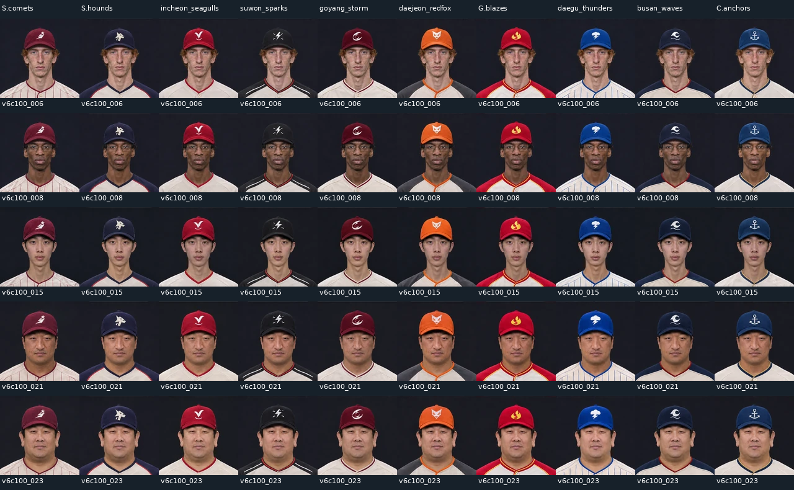

# v6c 정식 선수 얼굴: 100명 × 10구단 홈

승인된 v6c10 B 방식으로 만든 **완성 사진 1,000장**입니다. 구단별 128·256px RGB WebP 시트 20장과 manifest, 선검수 증빙, 최종 시트 검수판을 제공합니다. 게임 연결 검토를 위해 `assets/v6c-production-review` 브랜치로 납품합니다. 게임 코드·빌드·검사 파일은 수정하지 않았습니다.

[10구단 요약 비교판](previews/overview_10_clubs.png) · [manifest](manifest.json) · [연결 안내](CLAUDE_HANDOFF.md) · [검수 결과](validation.json)

## 인물 선검수와 동일인 유지

의상 편집 전에 후보 200명에서 100명을 선정하고, 고정된 ArcFace 모델과 원시 코사인 점수로 별도 재검사했습니다. 선검수 완료 시각은 `2026-11-05T16:09:47Z`, 첫 채택 의상 생성물 저장 시각은 `16:13:50Z`입니다. 선검수 원본 100장, 임베딩, 4,950쌍 점수와 이미지 해시는 [identity_prescreen](identity_prescreen/)에 고정해 두었습니다.

|검사|대상|결과|
|---|---|---|
|서로 다른 인물 선검수|의상 편집 전 100명, 4,950쌍|최대 **0.3997032344**, 전부 **0.40 미만**|
|구단 변경 후 동일인|최종 128px WebP, 4,500쌍|최저 **0.8444136381**, 0.60 미달 0쌍|
|구단 변경 후 동일인|최종 256px WebP, 4,500쌍|최저 **0.8579791784**, 0.60 미달 0쌍|
|최종 얼굴 검출·원 인물 식별|100명 × 10구단 × 2크기|**2,000/2,000**, 원 인물 Top1 일치|

0.40의 필수 적용 범위는 요청하신 **의상 편집 전 새 인물 100명**입니다. 의상 편집 후 사진끼리의 다른 인물 점수는 별도로 공개했으며, 모든 최종 사진이 0.40 미만이라는 뜻은 아닙니다. 최종 256px 구단별 다른 인물 최대 점수는 0.5683~0.6228이고, 0.40 이상은 구단별 160~329쌍입니다. 상세 값은 `validation.json`의 `final_uniform_different_identity_informational`과 `validation/teams/`에 있습니다.

기존 v6b와의 교차 비교는 별도 참고 항목입니다. 새 선검수 100명과 v6b 100명 사이 최대 0.4862017035, 0.40 이상 7쌍으로, 기존 인물과 합친 200명 통과를 주장하지 않습니다. 이번 세트의 인물 ID는 `v6c100_001`~`v6c100_100`이며 시범판 ID와 분리했습니다.

나이는 설정상 18~38세입니다. 18~22세 24명, 23~27세 24명, 28~32세 24명, 33~38세 28명으로 구성했습니다. v6b와 같은 한국인 85명·외국인 15명 비중이며, 외국인은 백인 4명·흑인 4명·라틴 5명·외국 아시아인 2명입니다. 안경 19명, 수염 19명이며 얼굴형·목 굵기·체형·머리 모양을 달리 생성했습니다. 이 정보는 가상 인물의 제작 설정입니다.

## 사진과 유니폼

각 인물의 머리·목·어깨가 자연스럽게 이어지는 전체 사진을 생성했습니다. 코메츠 완성 사진을 동일인의 기준으로 고정하고 나머지 9구단 의상을 편집했습니다. 얼굴을 공통 상체에 붙이는 작업은 하지 않았습니다.

모자는 눈썹 바로 위까지 깊게 쓰도록 생성했고, 크라운 이음선·단추·챙 두께·음영·자수와 칼라·단추·천 질감을 사진 안에 담았습니다. v5b 홈 키트의 색·줄무늬·칼라·모자 심벌을 참조했습니다. 자수는 사진 속 재현이므로 인물마다 미세한 바느질 차이가 있습니다. 쇄골까지의 구도여서 그 아래 가슴 글씨와 전체 유니폼은 이 얼굴 에셋 범위 밖입니다.

전원 256px 사진을 검수하고, 최종 128px 시트에서 모자 상단이 `y=10` 가이드보다 아래에 있는지도 전수 확인했습니다. 이는 512 기준 40px에 해당합니다. `validation/headroom/`에 기준선을 그린 구단별 전원 검수판이 있습니다. 여백 판정은 육안 검수이며, 빨강 계열 모자의 보조 색상 추정값을 전체 모자의 자동 정밀 측정값으로 취급하지 않습니다.

생성된 원본 칸은 8명 판 약 443px, 마지막 4명 판 627px입니다. 코메츠는 전체 사진을 비율 유지해 약 390·552px로 잘라 구도를 맞췄습니다. 나머지는 생성된 전체 사진을 정사각형으로 잘라 축소했습니다. 구단별 사진의 크롭 좌표·원본 해시는 `validation/provenance.json`에 있습니다. 모자 늘리기, 배경 연장, UV 의상 오버레이는 사용하지 않았습니다. 납품 사진은 128·256px이며, 확대판은 이 최종 픽셀의 기술적 확대입니다.

## 검수 이미지

아래 전원 비교판의 사진은 **최종 WebP에서 꺼낸 실제 256px**입니다. 각 판은 10×10명, 2560×2800px이며 이름표 줄을 포함합니다.

|구단|전원 100명 비교판|
|---|---|
|서울 코메츠|[256px](previews/seoul_comets_all100_256.png)|
|서울 하운즈|[256px](previews/seoul_hounds_all100_256.png)|
|인천 시걸스|[256px](previews/incheon_seagulls_all100_256.png)|
|수원 스파크스|[256px](previews/suwon_sparks_all100_256.png)|
|고양 스톰|[256px](previews/goyang_storm_all100_256.png)|
|대전 레드폭스|[256px](previews/daejeon_redfox_all100_256.png)|
|광주 블레이즈|[256px](previews/gwangju_blazes_all100_256.png)|
|대구 썬더스|[256px](previews/daegu_thunders_all100_256.png)|
|부산 웨이브스|[256px](previews/busan_waves_all100_256.png)|
|창원 앵커스|[256px](previews/changwon_anchors_all100_256.png)|

[무작위 20명 모자·칼라 확대판](previews/random20/)은 고정 시드 `20261105`로 선택한 20명의 10구단 사진을 모두 담은 10장입니다. `selection.json`에 선정 ID·순서·원 사진 크롭 좌표가 있습니다. 모자는 2배, 칼라는 약 1.52배 확대했습니다. 해상도가 더 높은 새 원본으로 오인하지 않도록 표시했습니다.

## 런타임 파일과 검수 증빙

- 게임용: `manifest.json`, `sheets/128/*.webp`, `sheets/256/*.webp`. WebP 20장 합계 **10,607,372바이트**입니다. 화면 크기에 맞는 한 크기와 필요한 구단을 선택해서 불러올 수 있습니다.
- 좌표: `identities[].variants[team].sheets["128"|"256"].path`와 `rect:[x,y,w,h]`. 시범판과 같은 접근 형식입니다. `path`는 이 폴더 기준 상대 경로입니다.
- 검수용: `identity_prescreen/`, `previews/`, `validation/`, `validation.json`, `checksums.sha256`. 런타임에서 미리 불러올 필요가 없습니다.

시트는 RGB, 알파 없음, WebP quality 90입니다. 10×10 배열에 각 칸 사방 8px 가장자리 확장을 넣어 축소 시 이웃 얼굴이 섞이는 현상을 줄였습니다. 실제 사진 사각형은 manifest의 rect를 사용합니다. 128 시트는 1440×1440, 256 시트는 2720×2720입니다.

이 브랜치의 에셋 파일 검수는 완료했고, **게임 연결 후 사용자 확인은 대기 상태**입니다. 원정 유니폼은 포함하지 않았습니다.
