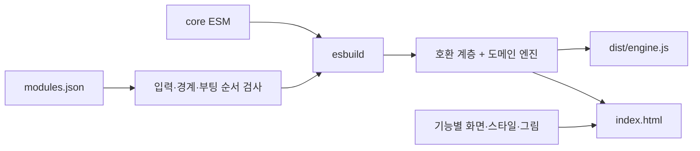

# 소스 구조와 모듈 경계

이 게임은 HTML 파일 하나로 배포합니다. 브라우저에서 모듈이나 패키지를 추가로 내려받지 않습니다. 개발 소스의 모듈 구조와 배포 형식은 구분합니다.

## 구성

- `src/core/*.mjs`: 수학, 주입 가능한 난수원, 능력 척도 변환, UTC 날짜 계산. 게임 상태나 화면을 참조하지 않는 실제 자바스크립트 모듈입니다.
- `src/engine/<도메인>/`: 리그, 선수, 경기, 진행, 계약, 드래프트, 시장, 경력, 스태프, 육성, 재정, 소식, 실행 기반을 나눕니다.
- `src/ui/<기능>/`: 화면과 기능별 패널, 공용 컴포넌트, 메뉴 틀, 동작, 부팅, 포함 데이터를 나눕니다.
- `src/css/<기능>/`, `src/gfx/<기능>/`: 스타일과 그림의 담당 영역을 나눕니다.
- `src/modules.json`: 모든 소스 파일과 적용 순서, 공용 모듈 진입점, 라이브러리, 문서 틀, 부팅 위치의 유일한 목록입니다.

공용 계산은 `core/index.mjs`에서 내보내고 esbuild가 `FrontOfficeCore` 하나로 묶습니다. 게임의 `runtime/00_base.js`와 `league/05_calendar.js`가 기존 이름으로 연결합니다. 난수는 여기서 기존 `Math.random`을 주입하므로 검사에서 지정한 시드와 호출 순서를 유지합니다.

게임과 화면의 기존 선언은 여전히 전역 공간을 공유하며 `G`, `UI`, `A`의 저장·호출 방식도 유지합니다. 이번 구조는 전역 상태를 모두 제거한 전환이 아닙니다. 기존 호출부를 유지한 채 공용 계산부터 분리한 호환 구조입니다.

## 빌드와 검사



`bash build.sh`는 검증과 메모리상 번들 생성을 마친 뒤 결과물을 교체합니다. 소스 누락·중복, 저장소 밖 경로, 공용 모듈의 경계 이탈·순환·미사용 등록, 동작/결재/부팅 순서 위반, 번들 문법 오류는 출력 전에 실패합니다. 정적 검사와 정리·에셋 도구도 같은 목록을 읽습니다.

```bash
cd tools && npm ci && cd ..
bash build.sh
node --test tools/test/*.test.cjs
bash tools/check.sh
```

화면 검사는 검사 프로세스가 소유하는 임시 HTTP 서버로 HTML 하나만 제공하고, 성공·실패 모두 서버와 브라우저를 종료합니다. 별도 서버가 필요 없으며 시스템 브라우저는 `CHROMIUM_EXECUTABLE_PATH`로 지정합니다.

전체 검사 중에는 소스나 빌드 결과물을 바꾸지 않습니다. `bash build.sh --check`는 출력 없이 검사합니다. `node tools/build.cjs --engine-out /tmp/e.js`는 엔진만 별도 생성합니다.

## 변경할 때

1. 담당 도메인 폴더에 파일을 두고 `src/modules.json`에 등록합니다. 파일명 앞 숫자는 이전 위치 추적을 위한 이름이며 실제 순서는 목록으로 정합니다.
2. 새 순수 계산은 `.mjs` 모듈에 작성하고 `core/index.mjs`에서 내보냅니다. 공용 모듈은 등록된 공용 모듈만 참조할 수 있습니다. 난수는 직접 고정하지 않고 주입합니다.
3. 게임 규칙을 옮길 때는 상태 접근과 필요한 함수를 먼저 명시합니다. 기존 전역 이름이 필요하면 호환 함수를 남기고 실제 행동 진입점의 실패 테스트와 저장 호환성을 확인합니다.
4. `A` 초기화 뒤에 동작을 등록하고, 저장 불러오기와 첫 화면 그리기는 `runtime/99_boot.js`에 둡니다. 스타일 순서를 폴더 정렬로 바꾸지 않습니다.
5. 의존성은 `tools/package.json`과 잠금 파일을 함께 갱신합니다. 배포 HTML에 런타임 패키지 설치를 요구하지 않습니다.

계약·진행·상태 전환을 한 번에 다른 저장 형식으로 바꾸는 작업, 전역 상태의 완전 제거, 모든 화면을 독립 모듈로 감싸는 작업은 포함하지 않았습니다. 후속 분리는 기존 규칙과 저장 데이터를 유지하면서 도메인별로 진행합니다.

## 계약과 구단 행사 상태

지도자 계약의 `cs`/`ce`는 시작·종료 시즌이다. 신규 계약과 만료 재계약은 `staffCt`, 기존 계약 연장은 `staffCtExtend`를 사용한다. 시즌 종료 후 신규 계약과 기존 계약의 잔여 기간 복원은 서로 다른 기준을 적용한다.

우승 사업은 `G.champEvents[구단ID:우승연도]`에 보관한다. 단장 이직은 행사 소유권을 바꾸지 않는다. 기존 전역 행사 필드는 호환 참조이며, 저장 후 중복된 객체는 `champEventsInit`에서 완료 표시를 합치고 다시 연결한다. 개인 포상·공적은 기존 사용자 처리 경로를 유지하고, 구단 행사 등록·진행·부임 시 연결은 별도 함수로 처리한다.
