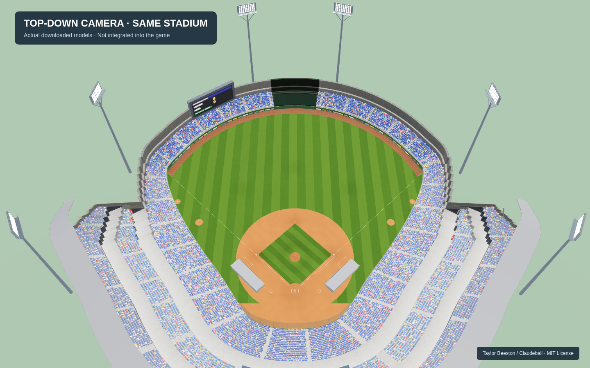
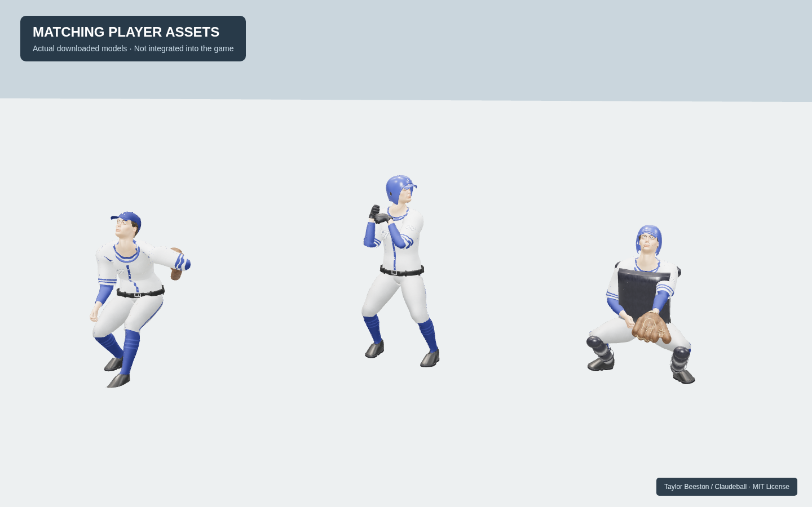

# 경기장·선수 에셋 검토

현재 경기 화면은 관중석 그림, 그라운드, 선수의 시점과 표현이 달라 어색하다. 경기장과 선수를 같은 좌표·화풍으로 구성할 수 있는 자료를 우선 확인했다. 이 문서는 후보 검토이며 게임에 적용된 화면이 아니다.

## 확인된 후보: Claudeball

- 원본: https://github.com/TaylorBeeston/claudeball
- 확인한 커밋: `424b1b512fd34a28d5078c9f644988b64e67b4ec`
- 제작자: Taylor Beeston
- 라이선스: 원작 README에 자체 코드와 에셋을 MIT로 명시. 상업 이용·수정·배포 가능, 저작권 및 라이선스 고지 유지. [원문 사본](LICENSE-claudeball.txt).
- 별도 판매하는 에셋 패키지가 아니라, 공개 야구 게임에 포함된 원본 모델이다.
- 외부 하늘 HDRI 등은 별도 출처·조건이다. 이 검토의 로컬 미리보기에는 사용하지 않았다.

### 원작 게임 화면

조명과 잔디 표현 등을 포함한 **원작 게임의 스크린샷**이다. 우리 게임의 적용 결과가 아니다.

### 다운로드한 실제 모델 미리보기

경기장·그라운드 GLB를 같은 좌표에 불러오고 카메라와 기본 조명을 설정했다. 별도 이미지 생성이나 기존 게임 화면 합성을 하지 않았다. 원작의 조명·후처리·잔디 셰이더를 재현한 화면은 아니므로 위 스크린샷과 품질 차이가 있다.

선수 GLB에 포함된 투구·타격 준비·포구 동작을 적용했다. 방망이는 별도 모델이라 아래 미리보기에는 장착하지 않았다. 팀 로고와 유니폼은 원본의 임시 표현이다.

### 실제 확인한 파일

| 구성 | 파일 | 확인 내용 |
| --- | --- | --- |
| 경기장 | `assets/optimized/stadium.glb` | 약 3.85 MB. 관중석·조명탑·전광판·외야 펜스·덕아웃 지붕 포함 |
| 그라운드 | `assets/optimized/field.glb` | 약 6.19 MB. 잔디·내야 흙·마운드·베이스·파울라인 포함 |
| 선수 | `assets/optimized/players_1k/player_base.glb` | 약 9.01 MB. 118개 애니메이션 확인. 투구 방식·타격·주루·포구 동작 포함 |
| 소품 | `assets/optimized/bat.glb`, `ball.glb` | 방망이·공 제공. 방망이 파일 다운로드 확인, 공은 저장소 파일 목록 확인 |
| 관중 | `assets/crowd/crowd_sheet.png` | 실제 이미지 확인. 관중용 스프라이트 시트 |
| 배치 | `field_layout.json`, `gear_defaults.json` | 경기장 좌표 및 역할별 장비 목록 제공 |

## 추천 방향

후보 중 실제 파일과 사용 조건을 확인한 것은 위 세트다. 경기장·선수를 같은 카메라로 렌더링할 수 있어 현재 화면의 시점 차이를 해결하기에 적합하다. 다만 기본 모델만 넣으면 원작 스크린샷의 품질이 나오지는 않는다. 잔디·조명·관중 표현을 함께 맞춰야 한다.

현재 2D 중계를 유지하려면 같은 카메라에서 경기장 배경과 선수 동작을 미리 렌더링해 쓰는 방식이 현실적이다. 이후 타자 뒤 시점까지 전환하려면 실제 3D 장면을 사용하는 별도 작업이 필요하다. 지금은 원본 모델을 게임에 추가하거나 런타임을 변경하지 않았다.

Kenney·itch.io·Quaternius·Poly Pizza의 원본 페이지는 이 실행 환경에서 접근이 차단되어, 해당 판매 페이지의 최신 구성·가격·라이선스는 검증하지 못했다. 미확인 상품을 추천 목록에 넣지 않았다.
