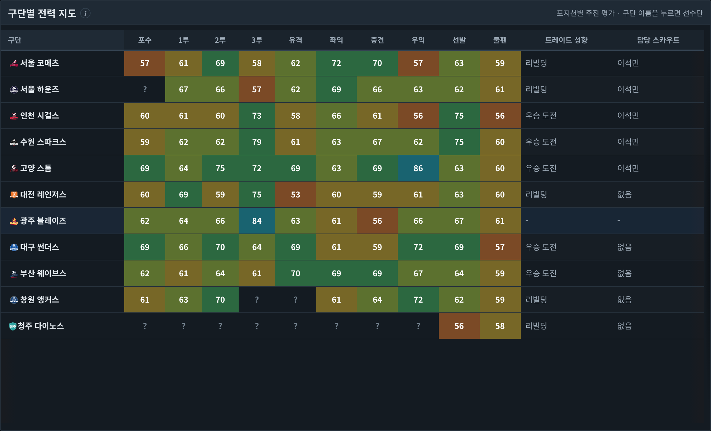
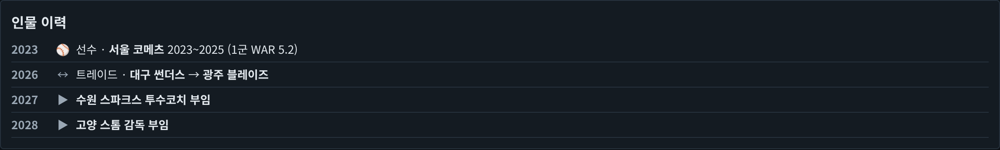
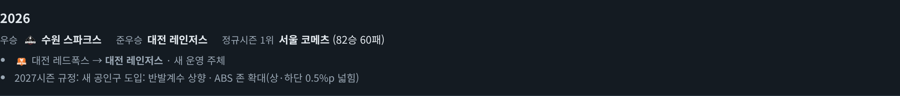
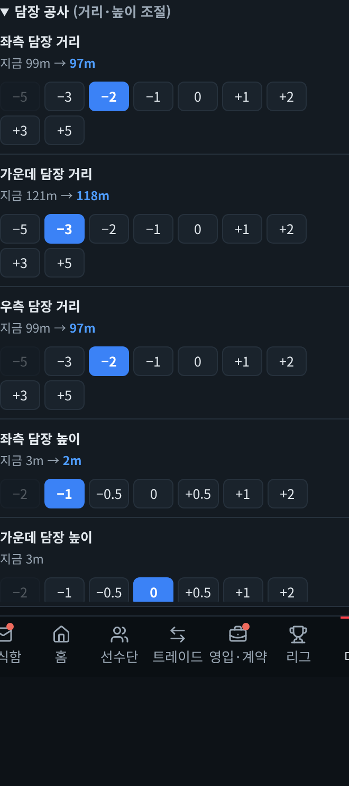
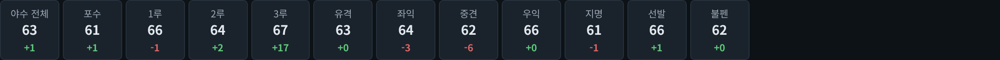
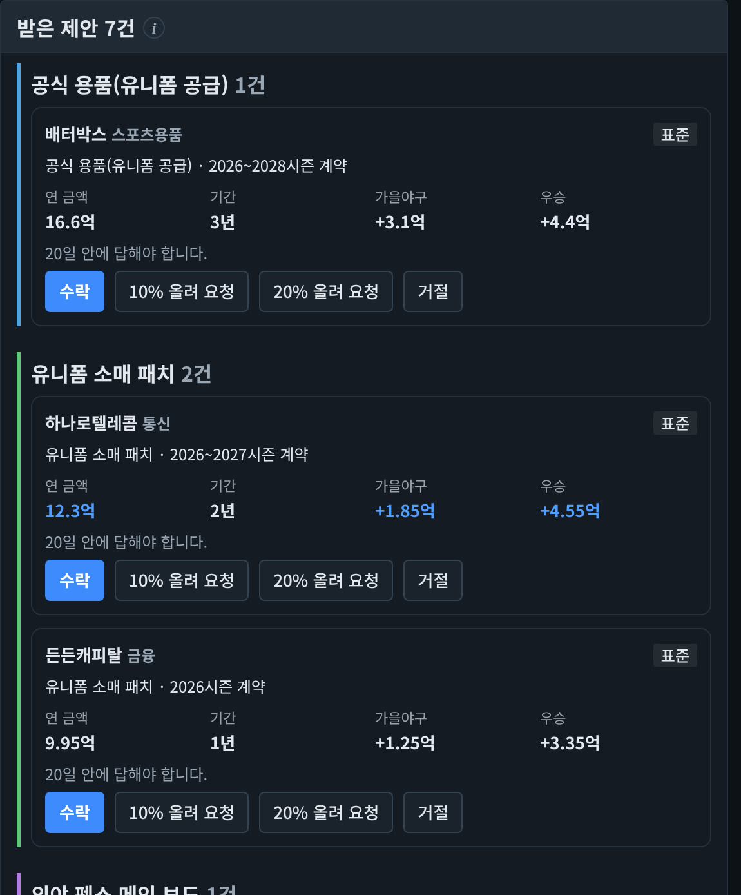

# [패치노트] 11월 11일 대규모 업데이트 — 리그가 살아 움직입니다

안녕하세요, 프런트야구 개발자입니다.
오늘은 카페에 남겨 주신 제보와 건의를 반영하면서, 리그 자체가 해마다 변하는 장기 기능을 한꺼번에 넣었습니다. 양이 많아 주제별로 나눠 정리했습니다.

---

## 1. 리그가 변합니다 (새 장기 기능)

**리그 확장 — 11·12구단 시대**
- 게임을 시작하고 10년이 지나면(2026년 시작이면 2036년부터) 협회가 신생 구단 창단을 추진할 수 있습니다. 해마다 10% 확률이라 실제 창단은 그보다 더 뒤에 일어나는 경우가 많습니다.
- 이듬해 6월 구단 표결로 승인되면 11월 특별지명(구단마다 보호선수 20명 밖에서 1명, 보상금 10억)을 거쳐 다음 시즌 1군에 들어옵니다. 부결되면 3년 뒤 다시 논의합니다.
- 구단 수에 따라 일정이 바뀝니다. 11구단은 상대별 14경기(140경기, 라운드마다 한 구단이 쉼), 12구단은 상대별 12경기(132경기)입니다.
- 신생 구단은 첫 신인 드래프트 1번 순번을 받고, 1군 첫 두 시즌 동안 외국인 선수 4명 보유와 외국인 연봉 총액 한도 +100만 달러 혜택이 있습니다.

**창단 단장**
- 창단이 승인될 때 명성 60 이상이거나 야인인 단장에게 창단 단장 제안이 옵니다. 수락하면 특별지명 날 신생 구단으로 옮겨 처음부터 팀을 만듭니다.

**구단 매각·이름 변경·연고 이전**
- 새 운영 주체가 구단을 인수하면 구단 이름이 바뀌거나, 드물게 지방 구단이 리그 밖 도시로 연고를 옮깁니다.
- 우리 구단이 인수되면 새 구단주가 이름 변경을 묻고 단장이 고릅니다.
- 지난 시즌 우승·순위 기록은 그때 이름으로 남습니다.

**협회 규정 변화와 시대 변화**
- 해마다 12월 18일 협회 규칙위원회가 다음 시즌 규정을 정합니다.
- 공인구 반발계수(홈런), ABS 존(삼진·볼넷), 외국인 선수 연봉 총액 상한이 바뀔 수 있고 실제 경기와 계약에 반영됩니다.
- 새 공인구가 도입되면 타고투저·투고타저 시대가 오기도 합니다.

**라이벌**
- 라이벌 맞대결은 관중이 더 들고(최대 12%), 우리 구단 라이벌전 승패는 팬 여론에 더 크게 남습니다.
- 주전급 선수가 두 구단 사이를 트레이드·FA로 옮기면 맞대결 열기가 오르고, 이런 사건이 쌓이면 새 라이벌이 생깁니다.

**내 이름의 구장**
- 한 구단에서 오래 일하며 우승을 이끈 단장(12시즌·우승 2회, 또는 15시즌·우승 1회)에게 구단주와 연고 도시가 구장 이름에 단장 이름을 붙이자고 제안합니다. 신구장이 열려도 이름을 잇습니다.

## 2. 역사가 남습니다

- **인물 이력부:** 선수 화면 경력 탭과 감독·코치·단장 화면에서 한 사람의 이력을 연도순으로 봅니다. 선수 시절 구단·이적·수상·은퇴 진로에 이어, 은퇴 뒤 코치·감독·단장 부임·퇴임까지 이어집니다. 이번 업데이트 이후 생긴 일부터 쌓입니다.
- **리그 연감(리그 → 역사):** 해마다 우승·정규시즌 1위·MVP·신인왕과 구단 이름·연고·구장 변화, 라이벌 탄생, 협회 규정 변화를 그해 이름으로 모아 봅니다.
- **영구결번:** 해외 진출 선수의 MLB WAR(그대로)와 NPB WAR(70%)를 더해 판단합니다.

## 3. 새로 생긴 기능

- **담장 공사:** 구장 화면에서 좌·중·우 담장 거리와 높이를 바꿉니다(비시즌 한 해 한 번, 공사비). 담장이 가깝고 낮을수록 홈런이 늘고, 높은 담장에 막힌 타구는 2루타가 됩니다. 공사 전에 바뀔 홈런 지수와 공사비를 미리 볼 수 있습니다.

- **리그 주전 평균 능력:** 우리 팀 현황·전력 요약·선수 화면에서 리그 주전 평균과 우리 주전의 차이를 자리별로 비교합니다. "어느 정도면 주전감인가"를 바로 볼 수 있습니다.

- **창단 드래프트 지명 방식:** 지그재그 외에 '같은 순서' 방식을 고를 수 있습니다. 모든 라운드를 같은 순번으로 뽑는 대신 순번별 조건(긴축·보너스)이 두 배입니다.
- **스폰서 제안 정리:** 받은 제안을 자리별로 묶고, 같은 자리에서 가장 높은 연 금액·보너스를 파란색으로 표시합니다.

- **감독 요청 조건 표시:** 감독의 영입 요청에 어떤 선수를 데려와야 인정되는지(시기·포지션·종합 능력·1군 등록 가능 여부) 함께 보여 줍니다.
- **보상선수 보호명단:** 종합 능력 옆에 잠재력 별을 함께 보여 줍니다.
- **지난 시즌 순위 탭:** 리그 → 순위에서 시즌 중에도 지난해 최종 순위를 봅니다.

## 4. 밸런스

- **투수 능력 반영 강화:** 구위·제구가 삼진·볼넷·피안타에 더 크게 반영돼, 좋은 투수와 나쁜 투수의 평균자책점 차이가 커집니다.
- **능력치 상향 평준화 완화:** 리그 상위 선수 평균이 시작 때보다 오르면 그만큼 겨울 성장과 신인 잠재력을 줄입니다. 10시즌 시험에서 화면 80 이상 선수가 4명→11명으로 늘던 것이 7명으로 줄었습니다.
- **FA 우회 차단:** 직전 연봉을 부풀려 보상금 때문에 다른 구단이 못 데려가게 한 뒤 헐값에 다시 데려오던 방법을 막았습니다. 주전급 미계약 FA·무적 선수의 요구액이 일정 수준 아래로 내려가지 않습니다.
- **급매 트레이드:** 급매 선수를 비슷한 종합의 1성 선수로 너무 쉽게 데려오던 문제를 고쳤습니다. 상대가 감수하는 손해 폭이 선수 가치에 비례합니다.
- **해외 진출:** 현지 1군에 자리 잡지 못한 선수는 계약 기간 전에 돌아오기도 합니다.
- **아시아쿼터:** 최상위 능력치 선수가 나오는 확률을 낮췄습니다.

## 5. 화면 개선·오류 수정

- 능력 차트가 위 칸 길이에 따라 작아지지 않습니다. 순위 변동 그래프를 실제 크기로 다시 그리고 구단 이름이 겹치지 않게 했습니다.
- 반쪽 잠재력 별이 조각나 보이던 문제를 고치고, 반쪽 별이 더 잘 보이게 했습니다.
- 선수단 위쪽의 다른 구단 버튼 줄을 없앴습니다(다른 구단은 리그 화면에서).
- 휴대폰에서 전체 영구결번 화면이 내려가지 않던 문제를 고쳤습니다.
- 저장 슬롯에 저장하면 화면이 맨 위로 튀던 문제를 고쳤습니다. 다른 슬롯에 덮어 저장할 수 있습니다(두 번 눌러야 덮어씁니다).
- 소식함을 방향키로 넘길 때 목록이 크게 튀지 않고 한 줄씩 따라갑니다.
- 로스터 정리 모드에 연봉 협상 중인 선수도 후보로 나옵니다.
- 중계 화면에서 '스트라이크·아웃·세이프' 같은 한글 판정 문구를 뺐습니다.
- 시즌 성과·업적은 그 시즌을 끝까지 맡은 단장에게 돌아갑니다. 시즌 도중 단장이 바뀐 구단의 역대 단장 기록도 재임 구간별로 나뉩니다.
- 그 밖에 재정·업적·면담 화면의 작은 오류 여러 건을 고쳤습니다.

---

오늘 반영한 항목 상당수가 카페에 남겨 주신 제보와 건의에서 나왔습니다. 감사합니다.
새로 들어간 리그 확장·규정 변화·라이벌은 시즌을 길게 진행할수록 체감되는 기능이라, 장기 플레이에서 어색한 점이 보이면 저장 파일과 함께 제보 부탁드립니다.

앞으로 들어갔으면 하는 기능은 '건의 아이디어' 게시판에 남겨 주세요. 프런트야구는 카페 여러분과 함께 만듭니다.
