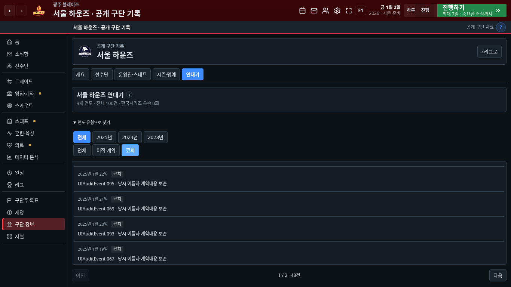
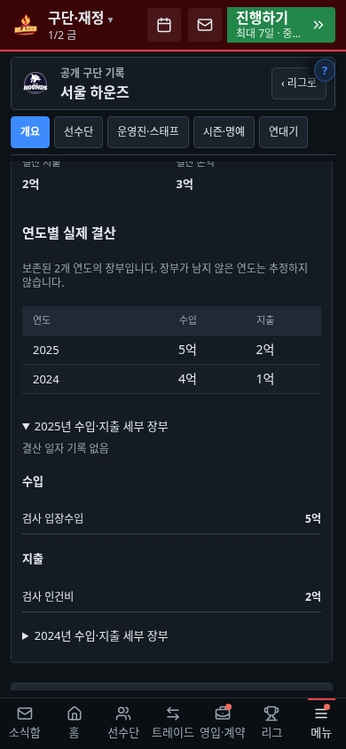
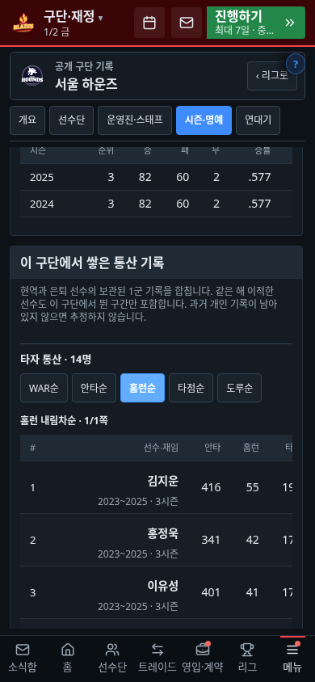

# 전 구단 기록과 공개 프로필 — 2026-11-10

AI 구단에서도 실제 발생한 인사·이적·시즌·운영 사건을 구단별로 보존한다. 다른 구단을 조회하거나 담당 구단을 옮겨도 해당 구단의 기록을 읽는다. 최근 소식 목록과 영구 연대기를 분리했고, 오래된 AI 은퇴선수의 개인 기록을 900명 한도로 삭제하던 동작을 제거했다.

## 구현과 근거

- `G.clubHist[tid]`: 구단별 영구 사건 장부. 당시 이름·역할·조건을 저장한다. 최근 `G.chron` 정리와 독립적이며 저장 복원 이후에도 유지한다. 같은 사건의 source 키로 반복 기록을 막는다. AI 사건은 사용자 단장의 취임·경질·우승 도전과제에 합산하지 않는다. 단장 레거시 연표·리더십 변화·홈과 구단의 최근 기록도 영구 장부를 읽으므로 타 구단 소식이 늘어났다고 사라지지 않는다.
- 인사: 실제 단장·감독의 경질·사임·만료·재계약·후임, 코치 사단 개편, 코치·스카우트·분석원 영입·이적·퇴직·은퇴. 후보 조회와 미수락 제안은 실제 취임으로 기록하지 않는다.
- 선수: 양 구단의 실제 이적·방출·계약, 현금·지명권 교환, 드래프트 지명, 군 입대·복귀, 해외 이동. 개인 기록은 그 선수가 실제 뛰었던 구단의 시즌 구간으로 집계한다.
- 운영: 시설·구장 착공과 완공·개장·버스 구매, 실제 비용·단계·예정일·완료일. 사임·이직 후 옛 구단에서 완료된 공사도 그 구단에 남는다.
- 시즌: 전 구단 승패·순위·실제 포스트시즌 결과, 수상·우승·퍼레이드·반지 수여식. `history[].fins`에 전 구단 실제 결산을 연도별로 보관하고 수입·지출·손익·기말 현금과 세부 장부를 조회한다.
- 영구결번: 우리 구단과 AI의 심사 기준을 현재 게임 설정으로 통일한다. 기본 WAR 60 설정은 **해당 구단 실제 1군 WAR 60·10시즌**, WAR 40 설정은 **WAR 40·8시즌**이다. AI에만 별도 우승 조건을 두지 않는다. AI는 자동 지정, 사용자 구단은 후보 선정 후 직접 지정한다. 이미 지정된 번호를 취소하거나 과거 은퇴자에게 소급 지정하지 않는다.

과거 저장은 남아 있는 시즌·이적·리그 소식·영구결번·결산 장부에서 확인 가능한 항목만 보충한다. 정확한 날짜가 없으면 ‘일자 기록 없음’, 보충한 자료는 근거 장부를 표시한다. 사라진 과거 개인 기록·인사·재정을 임의로 만들지 않는다. 성장 밸런스는 이 작업에서 조정하지 않았다. 별도 [10시즌 능력치 조사](../2026-11-10-rating-inflation-status.md)에 실측 결과와 미완료 상태를 구분했다.

## 공개 프로필

기존 구단 요약의 ‘구단 정보·연대기’로 연다. 개요 / 선수단 / 운영진·스태프 / 시즌·명예 / 연대기 다섯 탭, 구단 통산 기록의 항목 정렬과 20명 페이지, 연대기의 연도·종류 필터와 40건 페이지를 제공한다. 문서 전체 대신 패널 내부에서 스크롤한다. 다른 구단 조회는 `G.user`를 바꾸지 않으며 다섯 탭의 직접 조회 전후 저장 상태가 동일함을 검사했다. 우리 구단 예산을 타 구단 예산으로 표시하지 않는다.

AI의 공개 기록·선수단·운영진·시설·결산을 조회하는 화면이다. 플레이어에게만 있는 개인 재산·비공개 면담이나 타 구단 운영 권한을 생성하지 않는다.

## 독립 리뷰 수정

리뷰에서 단장 연표가 최근 소식만 읽던 문제와 이직 전 구단 팬 여론의 저장 위치 혼동을 재현해 수정했다. 연표는 최근 소식 1,000건 이후에도 실제 스타·공로자 기록이 표시되는지 검사했다. 팬 여론은 실제 `switchTeam` 이후 `G.clubT[tid].pr`의 마지막 보관 값 17이 표시되고 조회 전후 게임 상태가 같은지 세 화면에서 검사했다. 정확한 날짜가 없는 보충 기록은 홈·리더십 목록에서도 일자를 추정하지 않는다.

태블릿 홈 순위표는 기존 main에서도 마지막 두 구단이 내부 스크롤 아래에 숨던 것을 재현했다. 태블릿 순위표만 행높이를 맞추고 기존 글자 크기를 유지해 10개 구단이 카드에 모두 보이게 수정했다.

## 검증

검증 결과와 실행 범위는 [validation.json](validation.json), 실행 출력은 [checks.txt](checks.txt)에 기록한다. 사건별 고정 조건 테스트와 실제 경기·시즌 진행을 구분했다. 배포용 `index.html`로 공개 프로필·영구결번 이동·진행 중단을 검사했고, 소스 메모리 빌드로 사건별 회귀를 확인했다.

- [인사·시즌·우승](../2026-11-10-club-parity-executives.md)
- [코치·스카우트·분석원 및 시설](../2026-11-10-club-parity-staff.md)
- [선수 이동·드래프트·입대·보관 기록](../2026-11-10-club-parity-players.md)
- [개인·구단 기록 정확성](../2026-11-10-club-parity-records.md)
- [공개 프로필 UI](../2026-11-10-club-parity-ui.md)
- [분석원 9명 정원·감독 요청](../2026-11-10-analyst-capacity.md)

