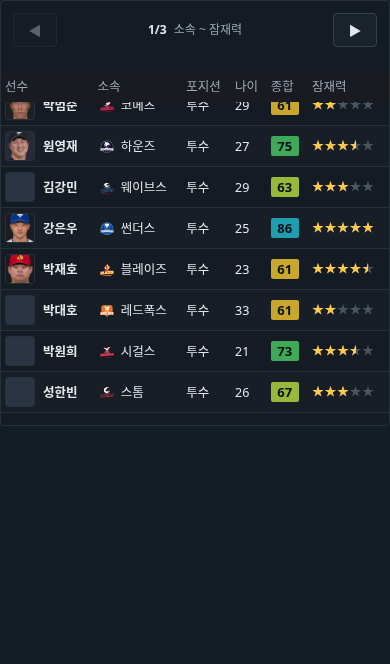
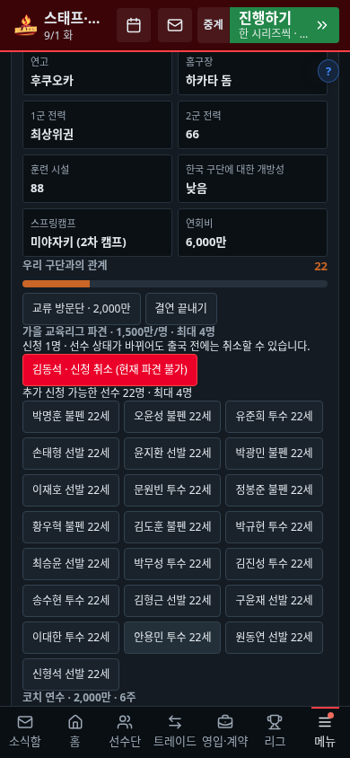

# 감독 요청·별 표시·추가 50건 — 2026-11-10

기준 main은 `3967df1f`다. 사용자가 제공한 PR #4의 13b9639 검수 문서는 [제보 원문](source-report.md)으로 보존한다. 제보와 현재 버전의 검증 결과를 구분했고, 요청별 고정 조건·실제 실행 경로·브라우저 검사와 두 시즌 자동 진행을 함께 사용했다.

## 감독 요청

두 보강 시스템(일반 면담의 `G.mgrReq`, 주간 요청의 `G.mreq`)과 유망주 기회 합의·감독 영입 약속·외국인 선호를 확인했다.

- 분석원 9명, 정식 선수 68명 정원이 차면 추가 채용·추가 영입을 약속하지 않는다. 기존 외국인 교체처럼 자리를 비워 바꾸는 요청은 교체 기간·횟수·쿼터를 별도로 검사한다.
- 생성 시점과 수락 시점 모두 검사한다. 대화 도중 정원이 바뀐 경우도 보상·관계 변화 전에 막는다. 불가한 요청 분기를 처음부터 걸러 중립적인 운영 대화로 대체한다.
- 실제 하위권인 자리, 곧 복귀하는 부상 주전, 2군의 출전 가능한 대안, 같은 요청의 재발 간격과 다른 보강 요청 중복을 검사한다. 분석원은 최소 연봉을 감당할 예산도 확인한다.
- 영입·등록 기간과 정규시즌 종료일을 확인한다. 국내 무적 영입은 기존 규칙대로 정규시즌 종료일까지 가능하며, 외국인 마감일과 혼동하지 않는다.
- 요청 이후·기한 안의 실제 영입만 완료로 인정한다. 부상·육성·연봉 미계약·군 복무·대표 차출·해외 파견·합류 예정·PS 등록 불가 선수를 즉시 보강으로 인정하지 않는다. 기존 선수 복귀도 신규 영입이 아니다.
- 분석원은 새 인물, 실제 채용일, 순증을 함께 본다. 겨울 FA의 다음 시즌 합류는 즉시 전력 요청과 구분한다. 외국인 교체는 당시 쿼터와 교체 기한을 보존한다.
- 이직·감독 교체 뒤 전임 요청·선호·기회 합의가 새 구단이나 후임 감독에게 붙지 않는다. 이미 수락한 뒤 스스로 정원·예산·교체 횟수를 소비했다고 약속을 무조건 지우지는 않는다.
- 유망주 기회 합의의 후보 목록과 실행 조건을 일치시키고 실제 우리 구단 경기 기록으로 월간 기회를 계산한다. 등록할 수 없는 선수 미콜업을 감독 약속 위반으로 세지 않는다.

개별 근거: [일반 면담 28검사](../2026-11-10-manager-request-dialogue.md), [주간 요청 26검사](../2026-11-10-manager-request-events.md), [기회 합의·약속 16검사](../2026-11-10-manager-request-promises.md).

## 별 표시

금색 별과 회색 별의 원점은 같았지만, 12px 줄 상자에 높이 17px 글리프가 놓이면서 `overflow:hidden`인 금색만 상하가 잘렸다. 공통 별 전용 CSS의 줄높이를 1.5로 맞췄다. 기존 프로필 원점 수정은 유지한다. 실제 다구단 선수 검색표와 프로필, 0~5 반별·3글꼴·3글자크기 99조합을 네 화면에서 검사했다. [검수 자료](../2026-11-10-rating-stars-tables.md).

## 첨부 목록 50건의 판정

| 번호 | 판정 | 변경과 근거 |
|---|---|---|
| 1~15 | 재현·수정 | 구단별 쿨다운·교육/코치 예약·환불 귀속·출국 재검증·실제 파견 가용성·빈 파견 보상 금지·연회비·20 차이 경계·시장 상한·전체 후보·취소/목적지 UI |
| 16~23 | 재현·수정 | 다음 시즌 예약·지급능력·왕복 이직 환불·실제 경기 이후 관계·AI 확정 가격·출전 당시 구단 기록·양 팀 실제 연습경기 |
| 24~25 | 규칙 정합화 | 해당 단계 캠프지의 자매구단만 성사율에 반영. 자매구단 우선 예약을 AI와 사용자에 동일 적용 |
| 26~27 | 재현·수정 | 일반 잔여석/자매 우선권 구분, 경기 수 상한을 선택 버튼과 실행에서 함께 적용 |
| 28 | 안내 보완 | 보호선수 35명은 최대 인원이라는 기존 부분 제출 규칙을 명시 |
| 29 | 정책 확인 필요 | 현금 0에서도 복귀 수락 후 반환 의무가 장부에 생기는 현행 동작. 즉시 현금 조건으로 바꾸지는 않음 |
| 30~37 | 재현·수정 | 등록 의무 충족/이동 후 상태, 새 거래의 구단별 기준선, 은퇴 뒤 지명권 선수 연결, 이동 종류·계약/정산 구분, 취소 알림 정리 |
| 38 | 별도 기능 요건 | 더블헤더의 개별 차전 지정은 현재 날짜 단위 예약의 기능 확장으로 남김 |
| 39~45 | 재현·수정 | 당일 경기 취소·대표 포지션 재검증·대체 발탁 보상·추천 전체 목록·스폰서 조건/제안 상한·연수 예약 취소 사기 악용 |
| 46 | 정상 동작 확인 | 과거 메일은 당시 재활 기간, 현재 결정은 변경된 병원 기준 기간. 과거 기사를 일괄 재작성하지 않음 |
| 47~50 | 재현·수정 | 해외 파견 선수 시범경기 제외·사인회 참가 상태·연말 부상/슬럼프 유지·월 계약 요금 보존 |

합계는 재현 오류 수정 44건, 규칙 정합화 2건, 안내 보완 1건, 정상 동작 확인 1건, 별도 정책/기능 요건 2건이다. 50건 전부를 버그 수정 완료라고 부르지 않는다.

- [자매결연·교육리그](../2026-11-10-followup50-sister.md)
- [캠프·시범경기](../2026-11-10-followup50-camp.md)
- [드래프트·거래·일정·대표팀](../2026-11-10-followup50-records.md)
- [스폰서·연수·팬·치어 운영](../2026-11-10-followup50-operations.md)

## 독립 리뷰에서 추가 수정한 경계

예약 후 이직한 선수의 해외 연수 중복 배정, 무적 계약 기록에 이전 연봉·기간이 저장되는 문제, 대표팀 영웅 보상이 언론 공개 약속의 성적 기준을 덮어쓰는 문제를 추가로 재현해 수정했다. 예약/실제 출국과 취득/계약 확정 시점을 나눠 검사했다.

## 과거 저장과 검증 범위

과거 거래에 구단별 당시 WAR 기준선이 없으면 같은 해 복귀 전 기여를 정확히 소급 분리할 수 없다. 기존 수치를 임의로 나누지 않고 트레이드 성적표와 단장 프로필에 한계를 표시한다. 구형 시범경기 합계는 출전 구단을 추정하지 않고 원본을 별도 보관하며 새 기록부터 구단별로 쌓는다. 원구단 메타가 없는 옛 지명권 기록도 임의의 선수에게 연결하지 않는다.

최종 실행 결과는 [validation.json](validation.json)과 [checks.txt](checks.txt)에 기록한다. 전체 check.sh를 실행했다고 주장하지 않는다. 사건별 테스트는 통제 fixture를 포함하며, 2026~2027 두 시즌 실제 일일 진행과 브라우저 클릭은 별도 검사다.

