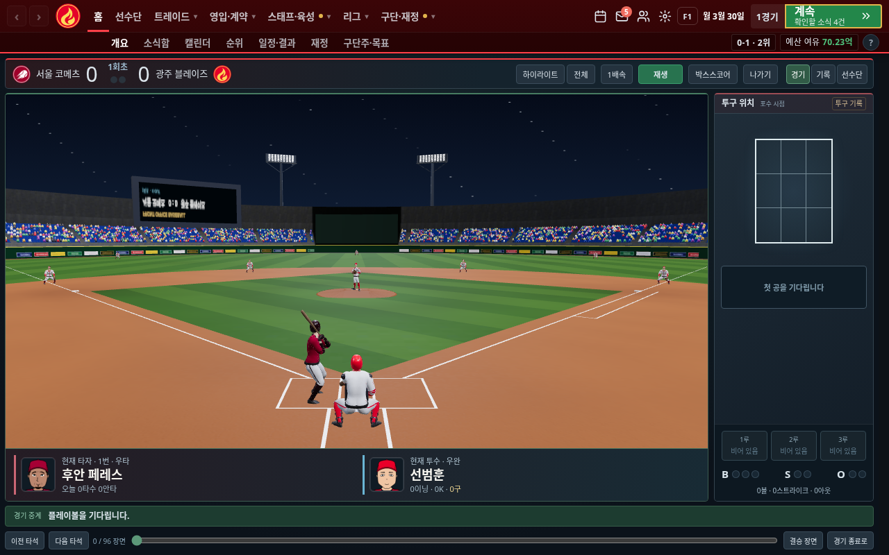

# 3D 경기 직접 재생 후 수정

수정 전 경기 화면에서 좌·우 타석을 바꿔 보고 여러 타석을 재생했다. 기본 타격 애니메이션은 몸을 홈플레이트 쪽으로 세우고 왼쪽 어깨 너머로 투수를 보는 자세인데, 모델 전체를 외야 정면으로 놓아 타자가 옆을 보고 있었다.

- 우타자·좌타자가 각각 홈플레이트 쪽으로 몸을 세우고 투수 쪽을 바라보도록 수정했다. 스윙도 같은 기준으로 회전한다.
- 좌투수와 왼손 수비수의 모델·글러브 방향을 맞췄다.
- 투구의 출발점을 고정된 마운드 중앙에서 실제 애니메이션의 공 잡는 손 위치로 바꿨다. 릴리스 직전에 손에 든 공이 사라지고 같은 위치에서 공이 출발한다.
- 프레임마다 애니메이션 시간을 0.06초 이하로 잘라 느린 그래픽 환경에서 동작이 재생보다 늦어지던 문제를 수정했다.
- 타격 후 카메라는 착지점 대신 움직이는 공의 높이와 방향을 따라간다. 카메라 보간도 경과 시간에 맞춰 적용한다.
- 아웃·득점한 선수는 이동과 달리기 애니메이션을 함께 멈춘다. 다시 타석을 표시하면 자세와 배트를 복원한다.

아래 이미지는 실제 게임에서 캡처한 테스트 경기다.

[좌타자](02-left-batter.png) · [휴대폰](03-mobile.png)

`tools/check-match3d-review.cjs`는 우타·좌타·양타의 실제 머리 뼈 방향, 좌우 투수의 손 위치와 공 출발점, 중단·복귀 후 배트, 아웃된 선수의 동작 정지, 기록에 있는 타석의 실제 재생, 높은 타구의 카메라 높이, 선수 상세 복귀를 검사한다. 회전값만 비교하거나 실제 모델 없이 흉내 낸 테스트가 아니다.

기존 경기 결과·투구 기록을 결정하는 엔진은 변경하지 않았다.

확인한 검사:

- 모듈·빌드·투구 순서 단위 검사 8개, 정적 점검 통과
- 위 3D 플레이 리뷰 검사 통과: 우타·좌타·양타의 투수 방향 머리 벡터 Z 성분은 모두 약 0.949
- 3D 중계 4개 해상도, 재생·일시정지·타구 카메라·상세 복귀·외부 에셋 요청 없음·WebGL 대체 처리 통과
- 기존 기본 중계 6개 해상도와 공별 투구판·이전 저장 호환 검사 통과

엔진 변경이 없어 긴 시즌·능력치 민감도·전체 규칙 검사는 이번 수정에서 다시 실행하지 않았다.
