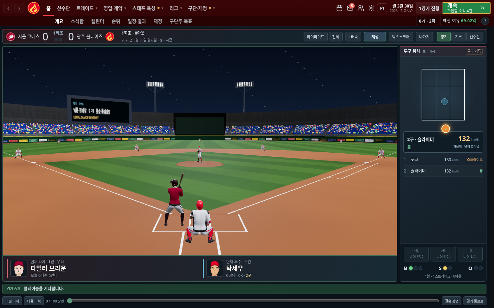

# 타자 뒤 시점의 3D 경기 중계

Taylor Beeston의 Claudeball 모델을 실제 게임에 연결했다. 아래 이미지는 원작 예시나 생성형 시안이 아니라 프런트타임에서 캡처한 화면이다.

- 경기장·관중석·조명탑·전광판·덕아웃·그라운드를 같은 3D 좌표에서 표시한다.
- 타자 뒤에서 투수를 바라보고, 타격 후에는 카메라가 타구 방향을 따라간다. 위에서 내려다보는 고정 배경을 사용하지 않는다.
- 현재 타자·투수, 좌우 타석·투구 방향, 팀 유니폼, 포수·수비수·주자를 연결한다.
- 저장된 공별 기록으로 투구·스윙·공 이동과 우측 9칸 투구판·구종·구속·볼카운트를 재생한다.
- 기존 상단바와 기록·선수단 보기를 유지하며, 선수 상세를 닫으면 같은 재생 시점으로 돌아온다.
- 3D 준비 중에는 재생을 기다리며, WebGL 미지원·로드 실패 시 기존 중계로 전환한다. 정지 장면은 매 프레임 다시 그리지 않고 화면을 떠나면 렌더러를 해제한다.

[휴대폰 화면](02-match-mobile.png) · [타격 후 카메라](03-hit-camera.png)

모델과 field-look 코드의 출처·라이선스는 [에셋 안내](../../../assets/match3d/README.md), 라이브러리 전문은 [사용 고지](../../licenses/match3d.txt)에 있다. 게임 결과는 기존 엔진이 결정하며 실제 추적 데이터가 없는 타구 위치와 움직임은 중계 연출이다. 원작의 전체 게임 코드·HDRI·음원이나 별도 심판·감독 모델을 가져온 것은 아니다.

단일 HTML에 모델·Three.js·텍스처 디코더를 포함해 약 34 MB다. 외부 모델 요청 없이 HTTP로 HTML 하나만 제공하는 검사 서버에서 실행을 확인했다. 이 클라우드 Chromium은 `file://` 접근을 관리자 정책으로 차단하므로, 다운로드 파일을 직접 여는 검사는 이 환경에서 완료하지 못했다.

확인한 검사:

- 모듈·결정적 빌드·투구 순서 단위 검사 8개 통과
- 기존 게임 규칙 413개 모두 통과
- 정적 점검과 변경 파일 공백 검사 통과
- 3D 실제 렌더링: PC 1440·1366·1920 / 휴대폰 390, 공별 재생·일시정지·타구 카메라·상세 복귀·렌더러 해제·WebGL 미지원 처리 통과
- 폰트·방문 통계 스크립트를 검사에서 대체한 상태로 3D 모델·텍스처·WASM의 외부 요청이 없음을 확인
- 기존 대체 중계 6개 화면 크기, 공별 투구판 4개 화면 크기와 저장·옛 기록 호환 검사 통과
- PC·휴대폰 기본 메뉴 빠른 UI 검사 통과

긴 시즌 시뮬레이션과 능력치 민감도 검사는 이번 그래픽 변경에서 다시 실행하지 않았다.
