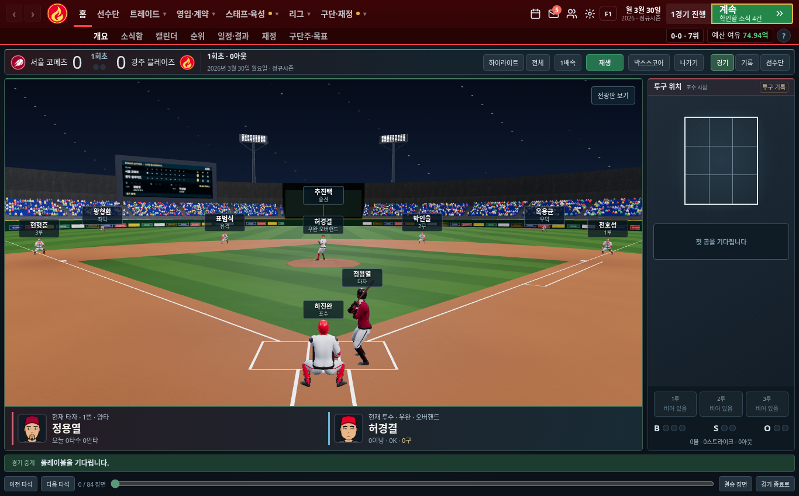
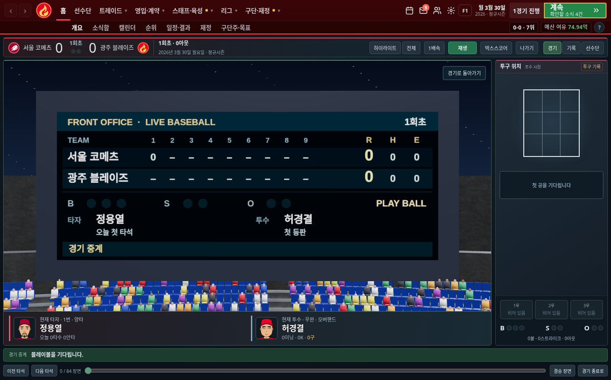
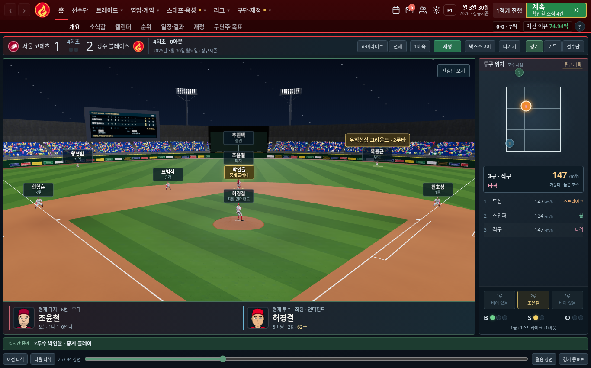
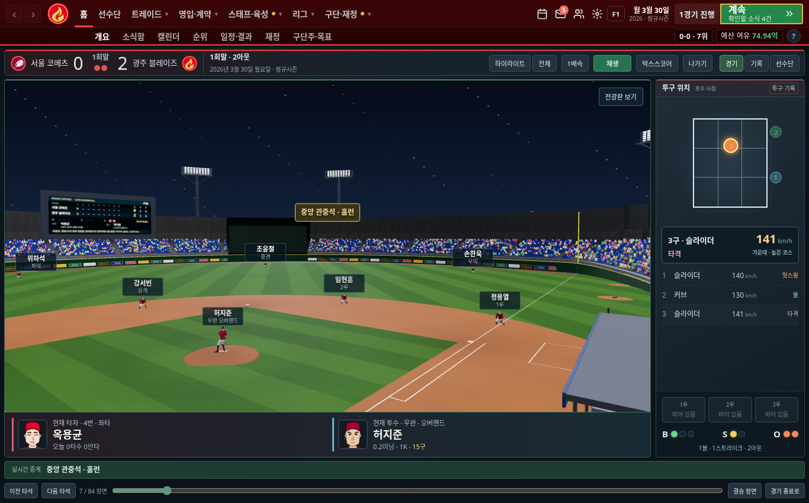

# 투구폼·타구 추적·트레이드 제안 개선

- 상대 트레이드 제안은 받는 선수의 가치가 내주는 가치의 97% 이상이어야 한다. 묶음 제안은 기존 중복 가치 할인(`stackIn`)을 적용하고, 핵심 선수를 요구하면 받는 선수 중 한 명이 대체 수준을 충족해야 한다. 선수 숫자로 낮은 가치를 채우는 제안을 차단한다.
- 받은 제안은 전체 10일, 같은 구단 21일, 같은 대상 선수 45일 재접촉 간격을 적용한다. 진행 중인 같은 구단의 제안과 2건 이상 쌓인 상태에서는 추가하지 않는다. 이미 받은 제안은 소급 삭제하지 않는다.
- 우완·좌완은 측면 준비 자세에서 포수를 보고 몸을 열며 던진다. 오버핸드·스리쿼터·사이드암·언더핸드와 와인드업·세트 동작을 구분하고 실제 손에서 공이 출발한다. 옛 저장은 선수 식별자로 일관된 폼을 복원하며 조회가 경기 난수를 소비하지 않는다.
- 투구와 스윙을 이벤트 시각에 연결하고 스윙의 후속 동작을 마친 뒤 주루를 시작한다. 공 궤적, 안타의 그라운드 착지, 홈런의 담장 밖 관중석 착지를 보여준다. 착지점에는 방향과 2루타·홈런 등의 결과를 표시한다.
- 수비는 기존 중계와 같은 담당 선수가 처리한다. 뜬공 포구, 땅볼 후 1루 송구, 병살의 두 차례 송구, 주루 아웃을 구분하며 담당 선수 이름과 동작을 강조한다.
- 하단 중계는 현재의 타구 처리·착지·송구·아웃 안내를 즉시 표시한다. 구장 자막이 세로로 길게 늘어나던 문제와 이름표·착지 안내 겹침도 고쳤다.
- 전 선수의 머리 위에 이름·포지션을 표시한다. 겹치는 이름표에는 연결선을 표시하고 선택하면 선수 정보로 이동한다.
- 뒤 전광판은 현재 재생한 기록까지의 이닝별 점수, R/H/E, B/S/O, 투타 정보와 공 정보를 표시한다. 전광판 보기 버튼은 경기 본문에서 확대하며 재생을 일시 정지한다.
- 첫 진입은 준비 화면을 표시하며 모델을 병렬로 불러오고 렌더링을 준비한 뒤 3D를 공개한다. 메뉴에서 경기 보기 버튼에 마우스를 올리면 모델 파일을 미리 받는다. 실패하면 이유와 재시도 버튼을 포함한 기본 중계를 표시한다.
- PC는 전체 페이지의 높이를 화면에 맞추고 상단바를 고정한다. 긴 명단·보고서는 본문 패널에서 스크롤하며, 상세 화면도 같은 영역을 사용한다. 시작 화면의 긴 패치 목록도 내부 패널에서 확인한다. 휴대폰 화면은 기존 동작을 유지한다.

타구 좌표는 저장된 타구 추적 데이터가 아니라 경기 결과에 맞춘 중계 연출이다. 경기 결과와 투구 기록은 기존 시뮬레이션이 결정한다. 3D 에셋 출처와 라이선스는 [에셋 설명](../../../assets/match3d/README.md)에 있다.

## 로컬 빌드 화면

Cloudflare 서비스의 배포 성공을 증명하는 이미지가 아닌, 같은 사이트 빌드를 로컬 Chromium에서 실행한 화면이다.

## 검증

- `tools/check-offer-review.cjs`: 불리한 2대1 거절, 합당한 2대1 허용, 실제 제안 생성과 재접촉 간격, 투구폼 조회·복원.
- `tools/check-desktop-fit.cjs`: PC 1280×720, 1366×768, 1920×1080에서 30개 메뉴의 페이지 높이와 상단바, 시작 화면 5종의 내부 스크롤.
- `tools/check-gameplay.cjs`: 첫 진입 2D 숨김, 준비 중 이벤트 응답, 이름표, 전광판 확대, 좌우 4가지 폼, 실제 기록의 땅볼·뜬공·병살·2루타·홈런, 모바일 크기.
- `CHROMIUM_EXECUTABLE_PATH=/usr/bin/chromium bash tools/check.sh` 전체 1회 통과: 규칙 413개, 모듈 9개, 능력 반영 2400경기씩·두 세계 평균, 2029년까지 세 조건 시뮬레이션, PC·휴대폰과 각 화면 회귀 검사.
- 전체 검사 뒤 폼 배정 분포·시작 화면 패널·전광판의 방금 끝난 타석 합계·실시간 문구·착지 안내 겹침을 보완했다. 관련 정적·모듈·트레이드/폼·PC 배치·경기 대시보드·공별 중계·3D 실제 기록 재생 검사를 재통과했다.
- 폼 배정식 외의 엔진 코드는 전체 검사 버전과 동일하다. 고정 난수의 세계와 3경기 결과도 배정 전후에 일치한다. 새 배정은 1000개 식별자에서 네 가지 폼의 다양성을 검사한다.

main 반영과 Cloudflare 배포 완료는 별개다. 현재 작업 환경의 네트워크 정책이 workers.dev 접속을 허용하지 않아 서비스 주소에서의 최종 확인은 하지 못한다.
