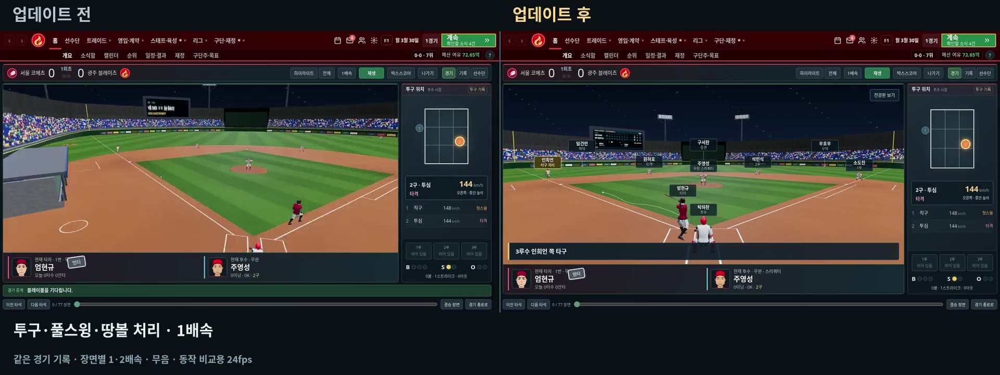

# 경기 중계 전후 영상과 게시글

[전체 다운로드](front-office-update-videos.zip) · [전후 비교 MP4](comparison.mp4) · [개선 후 MP4](after.mp4) · [이전 MP4](before.mp4) · [복사용 게시글](post.txt)

같은 시연용 저장 데이터에서 땅볼·2루타·홈런·도루 성공·도루자를 골라 두 버전에서 재생했다. 이전 영상은 `fed5df1`, 개선 후는 `2026-11-03q` 동작 구현이다. [게임 수정 코드](https://github.com/kkhkkh20-bit/front-office/tree/2dfd953000a98d16919cb0233f81c1f24d3df5b7)를 함께 확인할 수 있다. 실제 서비스에 접속해 녹화한 영상이 아니라 로컬 브라우저에서 실행한 게임 화면이다.

영상은 각각 32초, 무음, H.264/yuv420p MP4다. 장면별 1·2배속을 표시했고, 모든 장면이 끝나기 전에 잘리지 않았는지 확인했다. **동작 비교를 위해 고정 시간 간격으로 24fps를 녹화했다.** 영상의 프레임 수와 기기에서 측정하는 실시간 FPS는 별개다.

| 파일 | 용도 |
| --- | --- |
| comparison.mp4 | 게시글에 첨부할 나란히 비교 영상, 1920×720 |
| after.mp4 | 개선 후 화면을 크게 보는 단독 영상, 1280×800 |
| before.mp4 | 이전 버전 단독 영상, 1280×800 |
| post.txt | 제목과 본문 복사용 |
| upload-guide.txt | 간단한 첨부 순서 |
| comparison.jpg | 게시글 썸네일로 쓸 실제 영상 프레임 |
| video-info.json | 구간·재생 속도·코덱·길이·프레임 검증 정보 |

외부 게시판에는 자동 게시하지 않았다. 업로드 안내의 대괄호 문구를 실제 영상으로 바꾸고 본문을 복사하면 된다.

## 반영한 수정

- 원본 투구 클립에 있던 회전을 다시 적용하던 문제를 제거했다. 좌우 투수는 같은 홈 방향을 향하고, 원본의 측면 준비·골반·어깨 회전을 그대로 사용한다.
- 스윙을 자연스러운 속도로 연결하고 팔로스루를 보여준 뒤 뛰기 시작한다. 타구 카메라는 임팩트 직후에 바로 넘어가지 않는다. 삼진·헛스윙도 곧바로 동작이 사라지지 않게 보완했다.
- 투구 시각화의 가로 폭·높이·공 크기를 홈플레이트 기준에 맞췄다. 사구를 별도 판정하는 기능은 현재 없으며, 이번 변경은 몸쪽으로 과장돼 보이던 시각화를 수정한 것이다.
- 도루의 목표 베이스 인덱스를 고쳐 실제 다음 베이스로 이동한다. 포수 송구·슬라이딩·야수의 태그를 연결하고 저장 기록의 성공·도루자 결과를 그대로 표시한다.
- 중계 자막을 3D 구장 안쪽 하단에 유지하고 홈런은 느린 점멸로 강조한다. 자막 점멸은 동작 줄이기 설정을 따른다.
- 선수 모델을 경량화하고 화면 밖 관중·좌석 인스턴스를 생략한다. 관중 수·배치는 유지한다. 같은 기준 장면의 그리기 대상 삼각형은 약 185만에서 71만으로 줄었으며, 실제 FPS는 기기에 따라 달라진다. PC 픽셀 비율 상한은 1, 그림자 해상도는 1024다.
- 정지 동작과 이름표의 불필요한 갱신을 줄였다. 낮은 프레임으로 동작 전환 시간이 지나도 이전 자세가 섞여 남지 않게 검사·수정했다.

## 검증과 재생성

- 정적 점검, 모듈 10개, 경기 대시보드·공별 중계, 3D 시선·릴리스·중단/복귀, 실제 땅볼·뜬공·병살·2루타·홈런과 모바일, 사이트 배포/모델 재시도 검사 통과.
- 영상 녹화 중 팔로스루와 타석 카메라 유지, 투구 도착 위치, 도루/도루자의 슬라이딩·다음 베이스·태그 결과를 추가 확인했다.
- 세 MP4의 H.264/yuv420p·768프레임·32초를 검사하고 전체 디코딩을 통과했다.
- 확률·시즌 규칙 엔진은 변경하지 않았다. 이전 전체 규칙 검사 이후의 시각화 수정에 해당해 관련 검사를 실행했다.
- 재생성 도구는 `tools/capture-update-video.cjs`, `tools/package-update-video.cjs`. FFmpeg와 Chromium이 필요하다. 첫 after 실행에서 생성한 fixture.json을 before와 공유하며, 이 파일의 해시는 video-info.json에 남긴다. 관측용 고정 프레임 녹화와 실시간 성능 측정을 분리했다.

Cloudflare 배포 완료는 이 환경의 접속 제한으로 직접 확인하지 못했다. main 반영과 실제 배포 완료는 구분한다.
