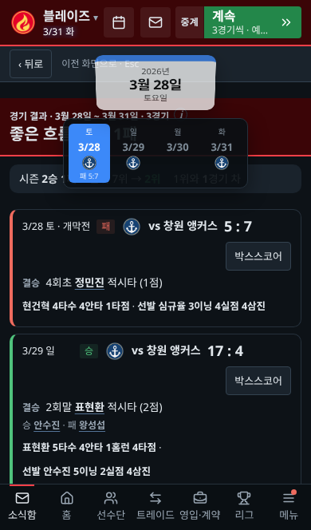
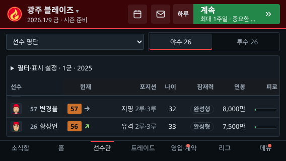
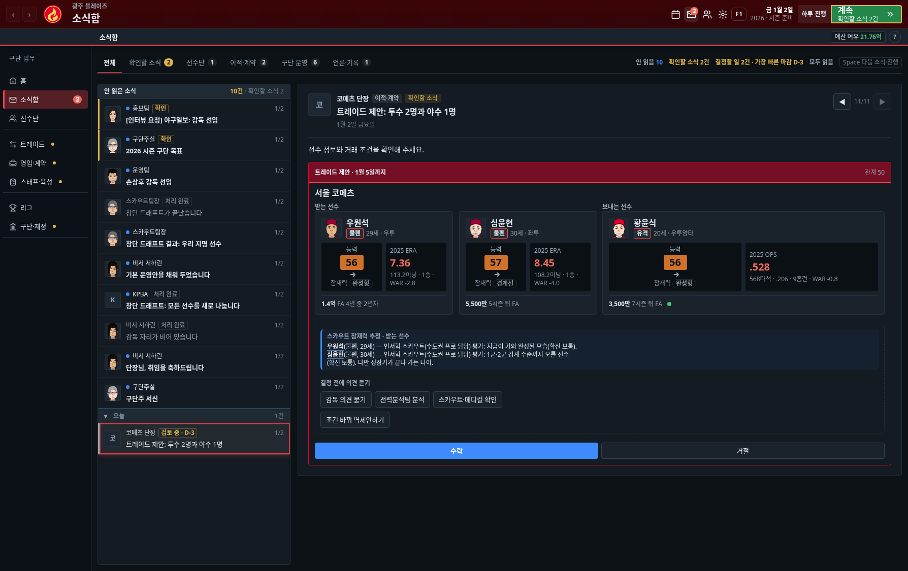

# 3경기 진행·터치 화면 리뷰

## 바뀐 동작

- 기본 ‘계속’은 **우리 팀 3경기**를 자동 계산한다. 휴식일은 세지 않고 결과를 한 묶음으로 보여 준다. 예약한 관전과 설정에서 켜진 중단 조건은 유지한다. 경기가 없는 비시즌은 최대 7일, 별도로 고른 ‘1주일’ 진행은 7일이다.
- 트레이드 중단을 꺼도 엔진이 새 제안에서 멈추고, 계속 버튼이 다시 확인을 요구하던 경로를 수정했다. 중단을 끈 제안은 소식함에서 계속 검토할 수 있다. 중단을 켠 경우와 필수 결정은 보존한다.
- 작은 모바일 화면에서 필터·열 설정이 선수 표를 밀어내던 문제를 수정했다. 탭은 선택 상자로, 필터·열 설정은 접는 영역으로 표시한다. 낮은 가로 화면은 홈 요약을 줄이고 카드 안에서 내용을 읽는다.
- 모바일 표 머리글에 남아 있던 화면 상단 기준 위치를 표 내부 기준으로 바꿨다.
- 달력에서 날짜를 누르면 해당 상세 보고 묶음을 바로 연다. 홈의 일정 바로가기도 선택한 날짜의 달력 상세로 이동한다.
- 모바일·태블릿 소식함도 목록 또는 본문 안에서 스크롤한다. 긴 트레이드 제안 때문에 화면 전체가 길어지지 않는다.
- 트레이드 양쪽 명단은 실제 영역 폭에 맞춰 카드 열 수를 결정한다. 능력·성적 칸과 포지션·나이·투타가 카드 밖으로 넘지 않도록 줄바꿈과 최소 폭을 맞췄다.

## 실제 조작 확인

Chromium의 모바일 설정·터치 입력을 사용해 배포용 `site/`를 검사했다. 화면 크기만 바꾼 검사와 별도로 실행했다. 실물 iPhone/iPad 또는 Safari 엔진 검증은 포함하지 않는다.

| 대상 | 세로 | 가로 |
| --- | --- | --- |
| 작은 휴대폰 | 320×568 | 568×320 |
| 휴대폰 | 390×664 | 664×390 |
| Android 크기 | 412×839 | 839×412 |
| 태블릿 | 768×1024 | 1024×768 |
| 큰 태블릿 | 834×1194 | 1194×834 |

- [x] 홈 탭·카드 페이지를 터치해 이동
- [x] 계속 버튼으로 진행하고 날짜 표시의 실제 중간 프레임과 마지막 날짜 확인
- [x] 날짜 효과가 화면 안에 표시되고 정상 종료되는지 확인
- [x] 손가락 이동 이벤트로 표를 스크롤하고 선수 상세에서 이전 목록 위치로 복귀
- [x] 선수단·스카우트·달력·설정의 모든 보고 묶음에서 내용 접근
- [x] 휴대폰·태블릿에서 동작 줄이기, 홈 일정 바로가기, 달력 날짜 선택과 진행
- [x] 날짜 효과가 남아 있는 동안 연속 하루 진행 후 화면 회전
- [x] 실제 3경기 계산 및 결과 묶음 위 날짜 표시
- [x] 재접속 후 저장된 날짜 복원

## 추가 검사

- `check-match-entry.cjs`: 실제 3경기 계산, 휴식일 제외, 명시한 7일 모드, 중단 설정 on/off, 예약 관전, 단일 경기 선택, 필수 업무 중단 검사 통과.
- `check-trade-layout.cjs`: PC·태블릿·모바일 7개 해상도에서 소식함의 실제 2:1 제안 카드 3개, 텍스트 경계, 수락·거절 버튼 접근 검사 통과.
- `check-workspace.cjs`: 33개 메뉴와 모든 보고 묶음을 4개 해상도에서 검사 통과.
- `check-continue.cjs`: 실제 스카우트 채용·위임·필수 업무 이동과 8개 화면/동작 설정 조합 검사 통과.
- 기존 소식함 완료·기한·요청 식별·실행 차단 검사 통과.
- 모듈·빌드 단위 검사 18개, 정적 점검, 소스와 생성 HTML 일치 검사 통과.
- PC·태블릿·모바일 공통 글꼴 5단계·패널·표·코치 카드 정렬 검사 통과.
- 전체 순차 검사와 실물 Safari 검사를 완료했다고 보고하지 않는다.

## 화면 기록

GitHub main 반영과 운영 사이트 배포 확인은 별개다. 운영 버전은 사이트의 `/release.json`과 배포 로그로 확인해야 한다.
