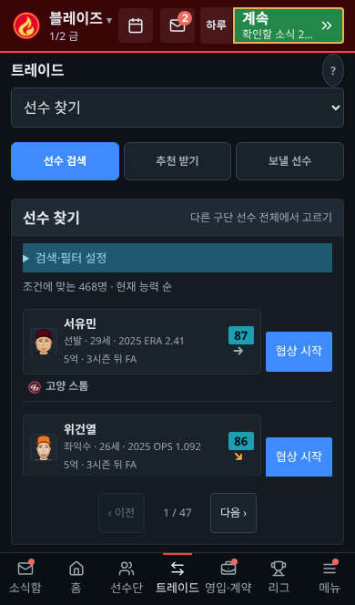
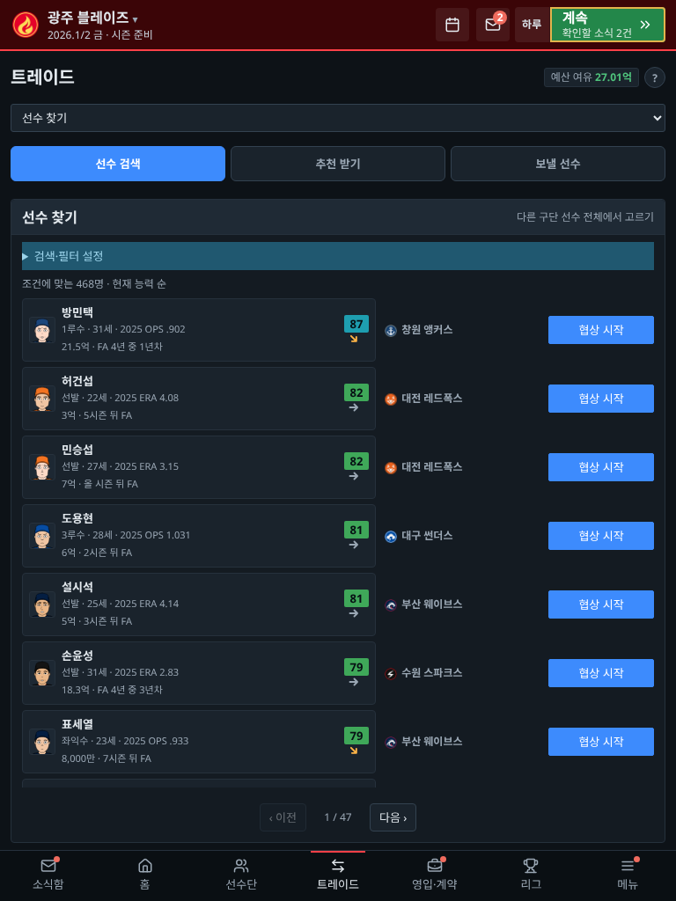
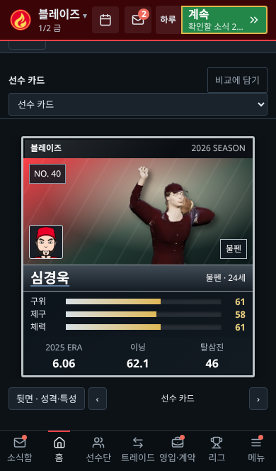
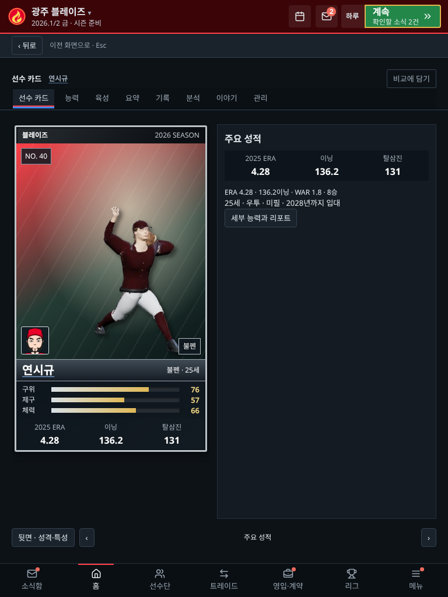
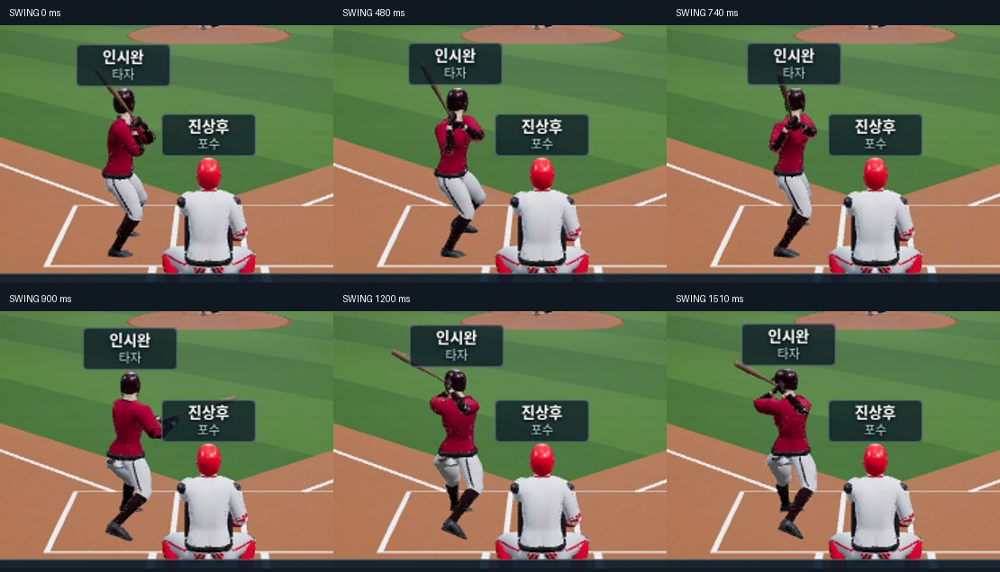

# 선수 카드·모바일 읽기·경기 속도 리뷰

## 실제 변경

- 프로 선수의 기본 화면을 세로형 카드로 전환. 앞면은 큰 타격/투구 이미지·선수 얼굴·능력 막대·연도가 붙은 주요 기록, 뒷면은 성격·관계·역할. 화살표로 성적/시즌 기록/계약/건강을 탐색하며 기존 세부 탭도 유지한다. 다른 구단의 비공개 성격·피로 정보는 노출하지 않는다.
- 카드 이미지는 저장소의 MIT 라이선스 선수 모델을 10개 팀 색 × 타자/투수로 렌더링한 20종 정지 이미지다. 실존 선수 사진은 사용하지 않았다. 메뉴에서는 WebGL을 실행하지 않는다. 재생성: `node tools/render-player-cards.cjs`.
- 모바일 주소창의 높이 변화에는 DOM을 다시 만들지 않고 화면 틀만 갱신. 명시적 재렌더에도 native details의 열림과 읽던 스크롤을 복원한다. 구단 선택의 ‘자세히’도 UI 상태에 저장하고 펼친 본문을 읽다가 구단이 선택되지 않게 한다.
- 모바일·터치 태블릿의 업무 탭은 높이가 고정된 선택 상자다. `flex:1`이 세로 선택 메뉴를 화면 절반까지 늘리던 문제를 제거했다. 검색·필터는 접고 목록 안에서 읽는다. 태블릿의 좁은 개별 패널에서도 목록의 선수 이름과 버튼이 겹치지 않도록 컨테이너 폭을 기준으로 배치한다.
- 카드 앞뒤/화살표 탐색은 빠르게 연속 눌러도 결정 버튼의 중복 터치 보호에 막히지 않는다.
- 검색 목록을 모바일에서 한 명으로 제한해 공간을 비우던 동작을 없앴다. 목록은 패널을 채우고 내부에서 스크롤하며 페이지 버튼은 고정한다.
- 작은 가로 화면에서 높이 98px인 설정 패널을 처리하지 않아 본문이 사라지던 하한 검사도 수정했다.
- 전체 화면을 다시 그릴 때와 선수 상세만 열 때의 읽기 복원을 분리. 상세를 닫으면 이전 선수 명단의 스크롤 위치를 유지한다.
- 경기 타구·수비·주루를 동시에 진행. 안타를 잡은 뒤 타자의 도착을 기다리던 순서를 없앴다. 송구 비행은 거리·송구 능력, 주루는 베이스 거리·주력, 수비는 이동 거리를 반영한다. 중계수는 외야 쪽으로 이동해 받고 커버 선수도 실제 거리만큼 이동한다. 취소된 주루가 아웃 선수를 다시 나타내지 않는다.
- 원본 스윙의 준비/로드/디딤/빠른 회전/팔로스루와 4가지 투구폼의 손 분리/디딤/릴리스를 재배치. 공 도착과 접촉 시점을 연결하며 원본 모델·트랙과 좌우 투타 구분은 보존한다. 잔여 fade가 준비 자세에 섞이던 문제도 수정했다.
- 단장 개인 지갑·월급·식사·재활 방문·교육·지역 활동·다른 단장과 교류를 추가. 구단 돈과 분리하고 월급과 연말 지급의 중복을 방지한다. 교육은 카드의 계약/훈련 판단 참고를 단계별로 연다. 선수 면담은 성격·역할·약속·최근 상황·대화 기록을 반영하며 다른 단장과 회장도 구단 상황에 맞춰 답한다.
- 훈련시설 6단계, 구장 시설 8단계. 기존 투자는 보존하고 상위 공사비·기간·유지비는 늘리며 효과는 완만하게 증가한다. AI 구단도 상위 훈련시설에 투자한다.
- 해외연수의 목표 능력·일정·개별/공통 비용·실제 선수별 결과 확률과 부상 위험을 표시. 귀국 전후 능력과 실제 결과를 저장해 확인한다.
- 처음 화면 → 불러오기에서 내보낸 `.txt`/`.json`을 직접 로드한다. 처음 화면에서는 빈 슬롯을 사용해 기존 슬롯을 보존하며 잘못된 파일은 현재 게임을 바꾸지 않는다.

## 검증

Chromium의 실제 터치 입력·기기 설정을 사용했다. 실물 iPhone/iPad 및 Safari 엔진 검증과 구분한다.

- `check-workspace.cjs`: 1366×768, 1920×1080, 1024×768, 390×844의 통합 메뉴 32개와 모든 보고 묶음(합치기 전 33개), 실제 휠·고정 머리글·선수 기록·상세 복귀·드래프트 통과.
- `check-feature-rules.cjs`: 월급/결산·회계연도 전환·기존 저장·활동 비용과 제한·공개 자료 기반 교육·해외연수 실제 확률과 전후 기록·상위 시설 공사/AI/비용·구장 공사/수입/저장 통과.
- 기존 규칙의 시설 3개, 구장 6개, 연수 5개, 면담 2개 통과.
- `STRICT=1 SEED=7 node tools/check-sim.js 2027`: 한 시즌과 다음 해 1월 1일까지 불변식 검사 통과.
- 전체 순차 규칙 415개를 이번 패치에서 다시 실행했다고 보고하지 않는다.

- 전체 단위 33개·정적 점검 통과. 타구 처리 직후 송구 시작/2루 도착 전 중계/최종 세이프 순서를 제어된 시계로 검사한다.
- `check-mobile-workspace.cjs`: 360/390/430/768/1366의 보직·검색·협상·제안 확인·단장·중복 터치 보호 통과.
- `check-experience.cjs`: 휴대폰·태블릿에서 카드 앞뒤/빠른 탐색, 실제 손가락 스크롤과 주소창 높이 변화 중 자세히 유지, 명시적 재렌더, 검색 목록 폭과 높이, 개인 활동 실제 비용/교육 표시, 실제 파일 다운로드·불러오기·기존 슬롯 보존, 구단 자세히 유지 통과.
- `check-design-system.cjs`: 1366/1024/390의 공통 글꼴 5단계·패널·표·코치 카드 정렬 통과.
- `check-touch.cjs`: 작은 휴대폰/휴대폰/Android/태블릿/큰 태블릿의 세로·가로 10개 조합, 날짜 효과·실제 스와이프·선수 복귀·설정 모든 묶음·회전·최대 3경기와 필수 결정 중단·재접속 통과.

- 기존 2:1 트레이드 제안 카드 7크기와 실제 최대 3경기 진행/필수 업무 중단/관전 예약 검사 통과.

- `check-gameplay.cjs`: 실제 12경기 기록의 땅볼/뜬공/사구/2루타/홈런/병살과 벤치 연출, 좌우 4종 투구·포수 측면 송구, 기록/점수 보존, 캐스터 한 줄·모바일·탐색 취소 통과. 순간적인 캡처 시점과 실제 완료 여부를 분리해 검사한다.

## 화면

## 동작 캡처

원본 스윙의 준비·디딤·임팩트·팔로스루를 같은 3D 중계에서 단계별로 캡처했다. 실제 시간의 FPS 측정과는 구분한다. 네 가지 투구폼의 단계별 클립 시간은 [기록](motion-phases.json)에 있다.

## 코치 수치

지도는 현재 경기력의 작은 보정에, 육성은 장기 성장 속도에 관여한다. 담당 분야 능력도 함께 적용하며, 해외연수 결과에는 실제 담당 코치의 육성 수치를 사용한다.

## 범위

논의한 AI 구단의 장기 리빌딩 전략과 전체 난이도 개편은 이 패치에서 구현하지 않았다. 시설 AI가 상위 투자 단계를 쓰는 변경과 구분한다. 투구/주루의 시각화는 저장된 경기 점수·아웃·진루 결과를 변경하지 않는다.

main 반영과 운영 사이트 배포 완료는 별도다. 운영 사이트의 `release.json` 요청은 이 실행 환경의 프록시에서 CONNECT 403으로 차단됐다. 운영 배포 완료를 확인했다고 보고하지 않는다.
