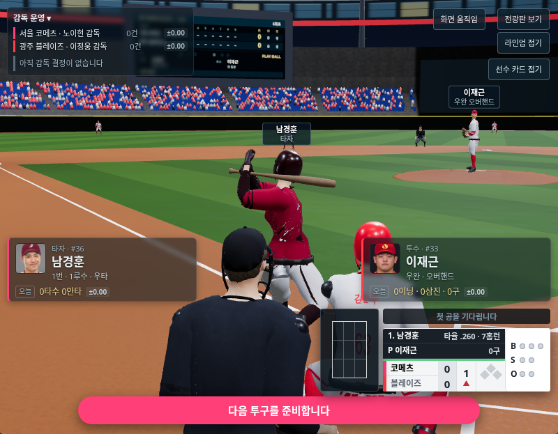
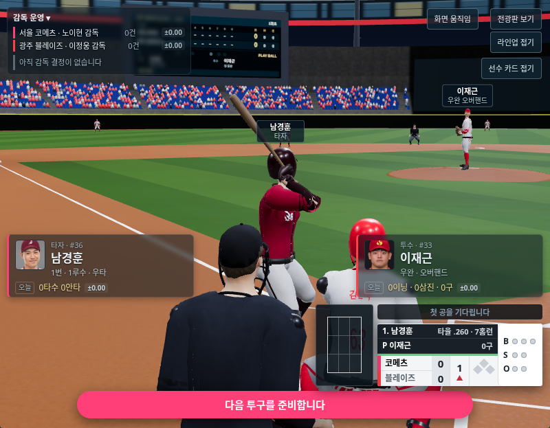

# 중계 동작·사운드 비교안

검토용 · 미배포. [전후 비교와 음원](preview.html)

## 변경 이유와 내용

- 풀스윙이 끝 자세에서 멈추던 부분을 고쳤습니다. 임팩트와 팔로스루를 마친 뒤 준비 자세로 돌아옵니다. 450·900·1400ms의 접촉 속도를 유지하며, 달리기·번트·장면 이동을 덮어쓰지 않습니다.
- 겹치는 관중 반응은 80ms 교차 페이드로 교체합니다. 타격·포구 효과음은 별도로 유지합니다.
- 음소거·일시정지·탐색·배속 변경·선수 화면 이동·경기 자연 종료 시 재생 중인 효과음과 예약음을 정리합니다. 원래 타격·포구·스윙 음색과 개별 음량은 유지합니다.

## 실제 비교

[실제 WebGL 전후 비교](checks/pose-comparison.txt). 같은 기록·카메라 목표로 스윙 시작 2.1초 후를 비교했습니다. 기존은 팔로스루에 멈추고 개선은 준비 자세로 복귀합니다.

| 기존 | 개선 |
| --- | --- |
|  |  |

[기존 음원](previews/sound-before.mp3) · [개선 음원](previews/sound-after.mp3)

음원은 실제 Web Audio로 같은 7초 구성을 렌더링했습니다. 투구→포구→스윙→타격→겹친 관중 반응→4초에 정지하는 비교입니다. 첫 1.6초의 원본 PCM은 동일하며, 정지 이후 4.5~7초 구간 RMS는 기존 0.08778 → 개선 0입니다. 게임에 이미 포함된 CC0 녹음과 합성을 사용했습니다. [기존 녹음 출처](../../../assets/match3d/audio/README.md).

## 수정 파일과 영향 범위

| 파일 | 수정 / 영향 |
| --- | --- |
| `src/scene3d/scene.mjs` | 실제 재생 속도로 스윙 종료 복귀 예약 |
| `src/ui/matches/20_art_sound.js` | 효과음 소유·종료·관중 교차 페이드·예약음 유효성 |
| `src/ui/matches/21_cast.js` | 재생 재시작·탐색·자연 종료와 지연 스윙/오르간 소리 |
| `src/ui/matches/25_scene_actions.js` | 지연 포구 소리의 재생 소유권 |
| `src/ui/actions/40_actions.js` | 일시정지·선수 화면 이동 시 소리 정리 |
| `index.html` | 빌드 산출물 |
| `tools/check-broadcast-{swing,sound,sound-render,motion-sound}-1121.cjs`, `tools/check.sh` | 독립 재현 및 회귀 검사 연결 |

영향 가능한 기존 기능은 스윙 후 주자 전환, 번트, 배속·일시정지·탐색, 음소거, 중계 종료, 선수 정보 왕복입니다. 경기 엔진 산출물은 기준과 바이트 단위로 동일합니다. 저장 구조·모듈 로딩 순서·메인 난수 `R()` 호출은 변경하지 않았습니다.

## 실행한 검사

- 수정 전 효과음 3개 실패 / 호환성 1개 통과 → 수정 후 4/4 통과. [수정 전](checks/sound-before.txt) · [수정 후](checks/sound-after.txt).
- 실제 rig/애니메이션으로 기존 스윙 복귀 실패 재현 → 450·900·1400ms 접촉, 전체 팔로스루, 준비 복귀, run 우선, 번트·탐색 유지 통과. [수정 전](checks/swing-before-final.txt) · [수정 후](checks/swing-after.txt).
- 실제 WebGL과 AudioContext에서 스윙 복귀 및 음소거·일시정지·탐색·배속·경기 자연 종료·선수 화면 이동 통과. 게임 기록 불변, 페이지 오류 없음. [결과](checks/actual-final.txt).
- 실제 Web Audio 전후 렌더링 통과. 기존 단독 타격음 파형 동일, 정지 후 무음. [결과](checks/sound-render-final.txt).
- 기존 모션·구종·관중 시야 검사 10/10 통과. [결과](checks/scene-final.txt).
- 빌드 2종 및 정적 검사 통과. [빌드](checks/build-final.txt) · [정적](checks/static-final.txt) · [엔진 동일성](checks/engine-parity.json).
- 독립 소스 리뷰의 자연 종료 소리 누락 지적을 반영했고 실제 자연 종료 회귀를 추가했습니다. 스윙 변경 독립 리뷰에서는 차단할 문제를 찾지 못했습니다.

## 미완료 검사와 남은 위험

`QUICK=1 bash tools/check.sh`는 진행 중입니다. GitHub 검사는 초안 PR에서 별도 완료해야 합니다. 전체 점검·장기 시즌 시뮬레이션과 실제 휴대폰 장시간 FPS·발열·스피커 청취는 미실행입니다. 현재 결과를 전체 검증 완료로 간주하지 않습니다.

관중 반응이 연이어 발생하면 이전 반응의 긴 꼬리가 교체됩니다. 이 소리 연출 변화는 위 음원에서 먼저 검토할 수 있습니다.

브랜치 `codex/broadcast-motion-sound-1121`. 최신 main `83de5da9`에서 시작해 기존 중계 비교안 #336의 `c655ddba`를 기준으로 포함했습니다. #326→#336을 먼저 해결한 뒤 최신 main을 다시 반영해야 합니다. 이전 UI #328은 보류 상태이며 포함하지 않았습니다. 선행 #326의 browser-and-sim·최종 check 실패도 별도 차단 요인입니다.

사용자의 시안 확인과 필요한 검사 완료 전 병합·배포하지 않습니다.
