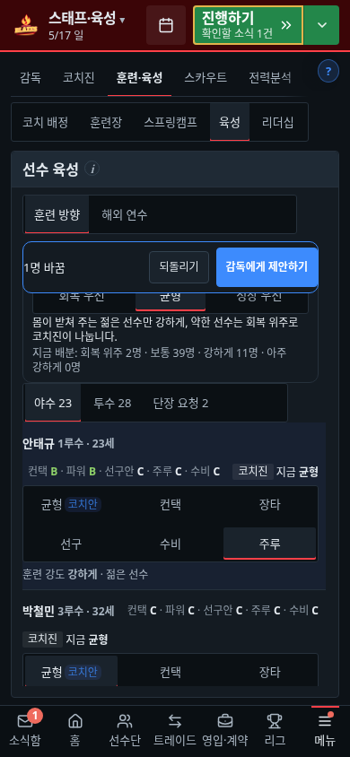

# 모바일 훈련·의료·시설 재원 안내

기준: `origin/main` `83de5da92d9c`. 작업 브랜치: `codex/mobile-training-medical-1121`.

## 변경 범위

- 휴대폰 훈련 방향 버튼을 3열로 줄바꿈해 마지막 주루 선택지까지 보여 줍니다. 선택·되돌리기·감독에게 제안하기 처리는 기존 것을 사용합니다.
- 모바일 부상 관리에 위험 선수와 최근 30일 복귀 선수의 접는 목록을 추가합니다. PC의 기존 위험 평가를 공통 함수로 옮겨 두 화면이 같은 기준을 사용합니다. 선수 이름을 누르는 기존 정보 열기 동작을 연결했습니다.
- 시설 재원 버튼 아래에 터치로 펼치는 비교를 추가합니다. 착공 때 구단 부담, 분할 후원금, 성적·관중 조건, 지역 교실비와 보조금 회수 조건을 표시합니다. 실행 불가 사유도 목록 안에서 볼 수 있습니다.
- 시설 금액은 기존 `facOwnPart`, `FAC_SPON`, `FAC_CITY`를 읽습니다. 재정·계약·훈련·부상 계산, 메인 난수, 저장 형식과 모듈 순서는 바꾸지 않았습니다.

## 수정 파일

- `src/css/foundation/12_ux_fixes.css`: 699px 이하 선수 훈련 버튼 줄바꿈.
- `src/ui/staff/34_staff.js`, `src/ui/staff/34b_staff_fm.js`, `src/css/staff/32_operations_art.css`: 의료 목록과 공통 표시 자료.
- `src/ui/facilities/61_fac_routes.js`, `src/css/facilities/16_campus_panel.css`: 재원 안내와 접는 표시.
- `src/ui/media/75_patch_notes.js`: 새 목록·비교 기능 안내.
- `tools/check-mobile-care-1121.cjs`, `tools/check-mobile-care-ui-1121.cjs`, `tools/check.sh`: 재현·회귀 검사 및 공통 검사 연결.
- `index.html`: 소스에서 다시 빌드한 산출물.

## 실제 렌더링

로컬에서 새 게임을 진행한 뒤 위험 선수와 복귀 기록을 고정한 검사 상태를 사용했습니다. 공개 배포판이나 실제 이용자 저장의 화면은 아닙니다.

| 훈련 방향 | 의료 목록 | 시설 재원 |
| --- | --- | --- |
|  |  |  |

[PC 의료 화면](desktop-medical.png)

## 검사 상태

- 수정 전: 새 재현 검사 3건 실패. 실제 브라우저에서도 휴대폰 선택지 잘림, 의료 상세·재원 펼침 부재를 재현했습니다.
- 수정 후: 재현 검사 3건 통과. 빈 명단·복귀일 보정·기간 없는 옛 기록, 지급 helper와 같은 착공 부담, 기존 실행 버튼 보존, 표시 과정의 상태·난수 불변을 확인했습니다.
- 실제 Chromium: 320·390·768·1366px에서 훈련 선택지와 가로 넘침, 모바일 의료 목록·PC 의료 화면, 시설 재원 터치 열기를 통과했습니다. 주루를 선택하면 제안 전 대기 상태만 바뀌고, 재원 안내를 열어도 현금·공사·장부는 바뀌지 않았습니다.
- 빌드 2종과 정적 검사 통과. 기존 직원 PC·모바일 검사와 `check-feedback-operations-20261110.cjs` 운영 회귀 검사 통과.
- `QUICK=1 CHROMIUM_EXECUTABLE_PATH=/usr/bin/chromium bash tools/check.sh` 실행 중. 종료 코드와 GitHub 검사 결과가 나오기 전 전체 검증 완료로 보지 않습니다.
- 전체 `bash tools/check.sh`는 이 화면 변경 브랜치에서 미실행입니다. 독립 다년 시뮬레이션·실기기 터치·iOS Safari도 미실행입니다.

## 영향과 남은 위험

영향 범위는 휴대폰 훈련 버튼 배치, 모바일·PC 의료 표시 자료, 공사 가능한 시설의 재원 버튼 주변입니다. 공통 검사와 GitHub 점검 대기 중이며 아직 병합·배포하지 않았습니다. 구장 PR #326 뒤에 순서대로 검토·병합해야 합니다.
