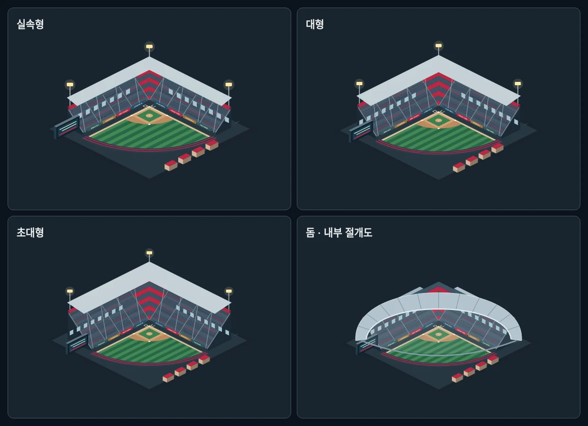
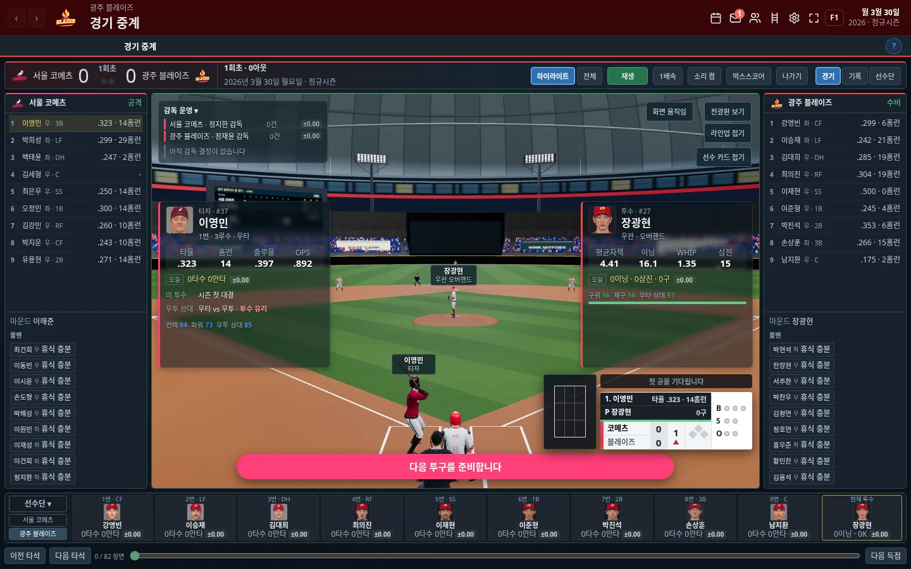
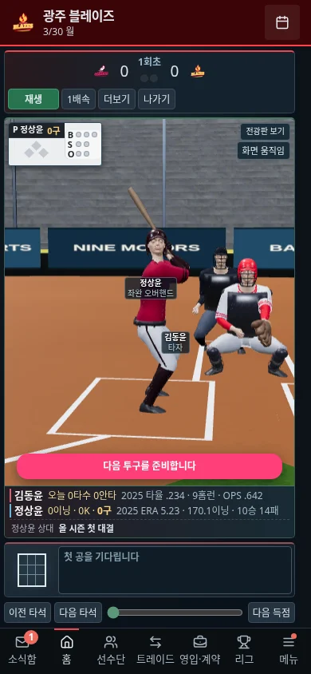
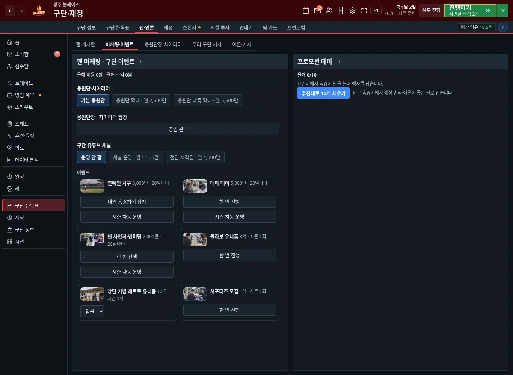

# 경기장·인게임 행사 디자인 시안

작업 브랜치: `codex/ingame-stadium-1121`. 최신 main `d8399c77`에서 시작했고, 작업 중 병합된 `83de5da9`의 경기 진행 성능 개선도 합쳤습니다. 사용자 승인 전에는 main 병합·배포를 진행하지 않습니다.

위 이미지는 로컬 Chromium에서 실제 SVG 함수와 게임 화면을 렌더링한 것입니다. 경기·구장 상태는 재현용 메모리 상태이며 실제 이용자 저장을 사용하지 않았습니다. 외부 폰트 요청은 차단하여 시스템 대체 글꼴로 확인했습니다.

1. **수정한 파일**: 구장 SVG·관련 CSS·구장 화면 옵션, 중계 화면 옵션·3D 장식 모듈, 행사 사진 3장·경로 매핑·사이트 패키징, 모듈 목록·패치 노트, 회귀 검사와 배포 파일 검사. 정확한 파일 목록은 PR의 Files changed에 있습니다.
2. **내용**: 완공된 구장의 종류·규모·돔 여부를 외관과 중계에 반영합니다. 관람석·잔디·통로·지붕을 보강하고 가상 광고판을 추가했습니다. 공사 중인 신구장은 현재 구장으로 먼저 표시하지 않습니다. 테마 데이·콜라보 유니폼·서포터즈 모집에 행사 사진을 연결했습니다.
3. **영향 범위**: 시설 화면, 중계의 구장 표시, 2D 대체 중계, GPU 장식 자원 해제, 행사 사진 표시와 사이트 에셋 배포입니다. 경기 규칙·메인 난수·구장 건립 비용·저장 구조에는 변경이 없습니다.
4. **실행한 점검**: 변경 전 정적 검사·기존 구장 시나리오·3D 상태/리뷰 검사가 통과했습니다. 신규 3개 회귀 검사는 수정 전 실패를 확인하고 수정 후 통과했습니다. 빌드 2종·정적 검사·실제 사이트 배포 파일 검사도 통과했습니다. 별도 리뷰에서 찾은 구버전 돔 필드 누락과 설계 좌석/경기 수용 인원 혼동을 보정하고 재현 검사를 추가했습니다. PC·모바일·WebGL 차단 화면에서 구장 및 사진 로딩을 확인했습니다.
5. **진행 중인 점검**: main 성능 개선을 합친 뒤의 공통 QUICK 검사, 장기 시즌 시뮬레이션, GitHub의 규칙 16분할 및 브라우저·시뮬레이션 결과는 최종 PR 상태에서 확인해야 합니다. 아직 전체 검증 완료가 아닙니다.
6. **남은 위험**: 구형 경기 기록에 당시 구장 종류 스냅샷이 없으면 과거 경기 재생도 현재 홈구장 외형을 사용합니다. 돔 그림은 경기 시야를 위해 절개한 표현이며 개폐식 지붕 규칙을 추가한 것은 아닙니다. 실제 모바일 기기별 FPS·장시간 발열은 별도 확인이 필요합니다.
7. **커밋·PR**: 브랜치의 최신 커밋과 연결된 PR을 기준으로 확인합니다. 시안 파일은 사이트 런타임에 포함되지 않습니다.
